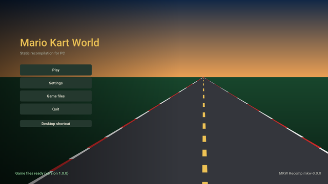

<!-- translated from README.md 64148490d940 -->

<p align="center"></p>

<h1 align="center">mkw-recomp</h1>

<p align="center">
  <b>ماريو كارت وورلد (Nintendo Switch 2) معاد تجميعها لتعمل أصليًا على Linux وWindows.</b>
</p>

<p align="center">
  <a href="https://github.com/adriadam10/mkw-recomp/releases/latest"></a>
  <a href="https://github.com/adriadam10/mkw-recomp/releases/latest"></a>
  <a href="https://github.com/adriadam10/mkw-recomp/releases/latest"></a>
</p>

<p align="center">
  <b><a href="https://github.com/adriadam10/mkw-recomp/releases">الإصدارات</a></b> ·
  <a href="../../CHANGELOG.md">سجل التغييرات</a> ·
  <a href="../../CONTRIBUTING.md">المساهمة</a> ·
  <a href="../../docs/research.md#sources">المصادر</a> ·
  <a href="../../docs/roadmap.md">خارطة الطريق</a> ·
  <a href="../../docs/performance.md">الأداء</a> ·
  <a href="https://github.com/adriadam10/mkw-recomp/issues">المشكلات</a> ·
  <a href="https://github.com/adriadam10/mkw-recomp/discussions">النقاشات</a>
</p>

<!-- i18n-bar:start -->
<p align="center">
  <a href="../../README.md">English</a> ·
  <a href="README.zh-CN.md">简体中文</a> ·
  <a href="README.es.md">Español</a> ·
  <b>العربية</b> ·
  <a href="README.hi.md">हिन्दी</a> ·
  <a href="README.pt-BR.md">Português (Brasil)</a> ·
  <a href="README.pt-PT.md">Português (Portugal)</a>
</p>
<!-- i18n-bar:end -->

<div dir="rtl">

إعادة تجميع ثابتة للعبة *Mario Kart World* (‏Nintendo Switch 2، الإصداران 1.0.0 و1.8.0) إلى برنامج أصلي للحاسوب يعمل على
Linux وWindows. تحتاج إلى نسختك الخاصة من اللعبة، مستخرجة من جهازك أنت: لا يوجد أي شيء من اللعبة في هذا المستودع ولا في
إصداراته.

**إنها إعادة تجميع، وليست محاكيًا.** يُترجَم كود AArch64 الخاص باللعبة إلى لغة C مسبقًا ثم يُجمَّع لمعالج الحاسوب (x86-64، أو
AArch64 على Linux)؛ لا يوجد مفسّر ولا JIT للمعالج. ولا تتم محاكاة الـ GPU أيضًا: أُعيد تنفيذ NVN2، واجهة الرسوميات في Switch 2،
فوق Vulkan على مستوى الواجهة، وتُترجَم مظلِّلات SM86 الخاصة باللعبة إلى SPIR-V مسبقًا. تُستبدل دوال SDK الخاص بـ Nintendo
(`nn::*`) بالاسم بكود خاص بنا.

## الحالة

في مرحلة مبكرة، ويتقدم بسرعة. حتى 12/11/2026:

- يقلع، ويعرض مقاطع الفيديو الافتتاحية، ويتنقل في القوائم ويخوض السباقات، على Linux وWindows (‏x86-64)، وعلى Linux بمعالج
  AArch64 (بملف AppImage خاص به؛ جُرِّب على جهاز محمول بـ Adreno 740).
- تجهّز شاشة البدء اللعبة من نسختك على جهازك (تولّد كود C وتجمّعه، وتترجم المظلِّلات، وتسخّن ذاكرة الـ pipelines المؤقتة)
  وتحتفظ بكل الإعدادات: العرض، وجودة الرسوميات، والتحكم، والتعديلات (hacks).
- تعمل السباقات بـ 60 إطارًا في الثانية على بطاقات الرسوميات القوية و30 على المتوسطة؛ انظر [الأداء](#performance).
- مشكلات معروفة: بعض القوائم (الوضع، واختيار الشخصية والمركبة) ما زالت تحتاج إلى عمل، وظل الكارت يفقد إطارًا من حين لآخر،
  وينقطع بعض الصوت أثناء مقاطع الفيديو، وقد يتجمد الـ GPU مع بعض تعريفات AMD. لا يوجد لعب عبر الإنترنت.

## خارطة الطريق

العمل الرئيسي المتبقي، بالترتيب؛ والتفاصيل في [docs/roadmap.md](../../docs/roadmap.md).

- **60 إطارًا في الثانية في السباقات.** اليوم إطار السباق سلسلة متتابعة: تُنهي اللعبة إطارها (~3 ms\*)، ثم تسجّل الواجهة
  الخلفية لـ Vulkan الإرسال الكبير للعبة (~19 ms\*)، ثم ينفّذه الـ GPU (~10 ms\*)، وعندها فقط يبدأ الإطار التالي.
  التسجيل على المسار الحرج، لذا فالعمل هو التسجيل بقدر أقل من المعالج: حالة ديناميكية فقط عند تغيّرها، وذاكرات مؤقتة للرسم بين
  الإطارات، وتسجيل متوازٍ، وخيط لعبة أسرع.
- **الصورة كما على الجهاز**: آخر أخطاء مترجم المظلِّلات، وظل الكارت، وpush constants، وصفر أخطاء في تحقق Vulkan.
- **فحص كل القوائم** مقارنةً بالجهاز: التالي هو الوضع واختيار الشخصية والمركبة.
- **لا تجمّد للـ GPU** وذاكرة رسوميات أقل، ثم تحميل بلا تقطّع وحزمة Linux للتوزيعات غير المتجددة باستمرار.
- **الإصدار 1.8.0 على قدم المساواة مع 1.0.0**: نسبة العرض فائقة الاتساع، وحجم خريطة الظلال، والبذرة الثابتة
  ([#19](https://github.com/adriadam10/mkw-recomp/issues/19)).

\* قيس في 09/11/2026 على جهاز الاختبار لدينا: معالج Radeon 660M المدمج (Ryzen 5 7535HS)، ‏Linux، دقة داخلية 720p.

<a id="performance"></a>

## الأداء

أزمنة الإطارات المقيسة، كل منها بتاريخه، موجودة في [docs/performance.md](../../docs/performance.md). لإضافة جهازك، افتح
[تقرير أداء](https://github.com/adriadam10/mkw-recomp/issues/new?template=performance.yml): يدخل الجدول بتاريخ التقرير. هذه
الأزمنة هي إطارات اللعبة نفسها: توليد الإطارات يعرض إطارات أكثر لكنه لا يقصّرها. ‏16.7 ms تعني 60 إطارًا في الثانية؛ ومع ضبط
Frame rate على Automatic (كما في الجهاز) ينخفض إلى 30 إطارًا عندما يتعذر بلوغ 60، والإطار الذي يتجاوز 33.3 ms يجعل السباق
أبطأ من الزمن الحقيقي.

| التاريخ | GPU | الدقة الداخلية | إطارات السباق | زمن إطار السباق |
|---|---|---|---|---|
| 11/11/2026 | RX 7900 XTX (Windows) | 2160p | 60 | 16.7 ms |
| 11/11/2026 | RX 9070 XT (Linux, RADV) | 720p إلى 2160p | 60 | 16.7 ms |
| 10/11/2026 | RTX 3060 (Windows) | 1080p | ~48 | ~21 ms |
| 11/11/2026 | RTX 3050 Laptop (Windows) | 720p | ~37 | 26.7 ms |
| 09/11/2026 | Radeon 660M (Linux, RADV) | 720p | 30-32 | 31-33 ms |
| 11/11/2026 | GTX 1650 SUPER (Windows) | 1080p | ~24 | ~41 ms |
| 09/11/2026 | GTX 1050 Ti (Windows) | 1080p | 22-24 | 42-45 ms |

## اللعب




1. استخرج Mario Kart World 1.0.0 أو 1.8.0 من جهاز Switch 2 الخاص بك (`exefs/` و`romfs/`، بعد فك تشفيرهما؛ والإصدار 1.8.0
   مع دمج التحديث في RomFS اللعبة الأساسية)، أو النسخة نفسها مجمّعة في ملف واحد `.nup` أو `.nx`.
2. نزّل المشغّل لنظامك من [الإصدارات](https://github.com/adriadam10/mkw-recomp/releases): على Linux ملف `.AppImage`
   (‏`-aarch64` على ARM؛ يحفظ اللعبة التي يجهّزها في `~/.local/share/mkw-recomp`؛ يتطلب glibc 2.31 أو أحدث: Debian 11 وUbuntu
   20.04 وSteamOS وما بعدها)، وعلى Windows ملف `.zip` بعد فك ضغطه في مجلد. يحتاج كلاهما إلى نحو 30 GB من المساحة الحرة.
3. شغّل ملف AppImage (بعد `chmod +x`) أو `mkw.exe`، وافتح **Game files**، وحدّد نسختك المستخرجة (**Choose folder** أو
   **Choose .nup or .nx file**) ثم اضغط **Set up**.
   يستغرق التجهيز الأول بعض الوقت (يجمّع اللعبة كاملة وينزّل `nvdisasm` و`ptxas` من NVIDIA، ‏84 MB على Linux و126 MB على
   Windows، لوصف ترميز المظلِّلات على جهازك)؛ بعد ذلك، **Play**.
4. عند صدور إصدار أحدث تعرضه شاشة البدء (**Update to vX**): تنزّله وتتحقق منه وتستبدل البرنامج وتعيد تجهيز ما تغيّر فقط.
   ويوقف **Settings → Menu → Check for updates** هذا التحقق.

المتطلبات: معالج x86-64 يدعم AVX2 (أو، على Linux، معالج AArch64 بمعيار ARMv8.2: ‏LSE وFP16 وRCpc وDotProd وCRC32)، وبطاقة
رسوميات تدعم Vulkan 1.3 (يُنصح بـ `VK_EXT_mesh_shader`؛ ومن دونه تعمل مظلِّلات task وmesh كحوسبة compute)، و16 GB من الذاكرة
مستحسنة. في حاوية Docker أو Podman على Linux، اسمح بـ `userfaultfd` في ملف seccomp الخاص بها (الإعداد الافتراضي لـ Docker
يرفضه): من دونه لا يعرف المنفذ أي ذاكرة من اللعبة تغيّرت، فيعمل أبطأ بعدة مرات.

## ميزات إضافية

ما يتجاوز الجهاز، وكلها اختيارية ومطفأة (أو على قيمة الجهاز) افتراضيًا:

- **العرض**: دقة داخلية أعلى أو أقل من دقة الجهاز، ونسبتا 21:9 و32:9 (تُظهر السباقات المزيد على الجانبين)، وتكبير AMD FSR 1،
  وHDR على الشاشات الداعمة له، وVSync، وعرض mailbox أو immediate.
- **توليد الإطارات**: إطارات تُصنع بين إطارات اللعبة (سباق بـ 30 إطارًا يُعرض بـ 60، أو بـ 240 على شاشة 240 Hz). أكثر سلاسة،
  لا أسرع: تصل الصورة متأخرة حتى إطار واحد، وقد تتلطخ الحركة السريعة والخريطة المصغّرة.
- **الرسوميات**: ترشيح الإكساء وجودته، ومسافة التفاصيل، وجودة الظلال، أعلى أو أقل مما في الجهاز.
- **الصوت**: صوت محيطي 5.1.
- **التحكم**: إمكانية إعادة تعيين كل مفتاح وزر، وكاميرا بالفأرة، وأيقونات أزرار Nintendo أو Xbox أو PlayStation، وتوجيه
  بالحركة، وشدة الاهتزاز؛ ولعب جماعي محلي بيد تحكم لكل لاعب.
- **التعديلات (hacks)**: تسريع (اضغط مطولًا على F2 أو بدّله)، وتخطي الفيديوهات، وفتح كل شيء، والعشوائية نفسها في كل مرة،
  والانتقال مباشرة إلى سباق الوقت أو التجوال الحر.
- **اللغات**: القوائم بـ 20 لغة؛ واللعبة نفسها أيضًا بالكتالونية والجاليكية والباسكية.
- **ملفات اللعبة**: نسخة مستخرجة كمجلدات أو كملف واحد `.nup` أو `.nx`، تُستخدم في مكانها؛ وتحديثات من شاشة البدء.
- **طبقة الأداء** (عدد الإطارات، أو المعالج والـ GPU والذاكرة بالكامل) ومعلومات النظام بنقرة واحدة لتقارير الأخطاء.

## التعديلات (Mods)

تثبّت صفحة **Mods** في شاشة البدء التعديلات كما تُنشر للعبة، وتعرضها في تبويبين:

- **Find on GameBanana**: تعديلات Mario Kart World على [GameBanana](https://gamebanana.com/games/22152)، معروضة أو مبحوث
  عنها، مع مؤلف كل تعديل وترخيصه ولقطات شاشته ووصفه. ينزّل **Install** الملف من GameBanana، فقط عندما تطلب ذلك.
- **Installed**: تعديلاتك، لكل منها مفتاح تشغيل وإيقاف؛ ويأخذ **Import zip / Import folder** تعديلًا لديك بالفعل (`.zip` أو
  `.rar` أو `.7z`، يحتوي `romfs/` و/أو `exefs/` في أي مكان بداخله، بما في ذلك بنية `atmosphere/contents/`).

التعديلات التي تستبدل ملفات اللعبة (`romfs/`: الأشكال، والإكساءات، والنصوص، والحلبات) تسري عند التشغيل التالي. والتعديلات التي
تغيّر كود اللعبة (رقع `.ips` أو `.pchtxt` في `exefs/`، مثل 200cc أو 30 FPS) تُدمج في كود اللعبة: تشغيل أحدها أو إيقافه يعيد
تجميع اللعبة قبل اللعب (بضع دقائق). يُدمج تعديلان يغيّران الأرشيف نفسه ملفًا بملف، وتسأل الصفحة أيهما يسري حيث يغيّر كلاهما
الملف نفسه. وتنبّه الصفحة إلى التعديلات التي تستبدل إعدادات رسوميات اللعبة أو مظلِّلاتها، والتي يعالجها المنفذ بطريقته.

التعديلات يصنعها أشخاص آخرون ولا يختبرها هذا المشروع: قد يتسبب تعديل في انهيار اللعبة أو إتلاف حفظك. اقرأ صفحة التعديل قبل
تثبيته، واحتفظ بنسخة من حفظك، وأبلغ مؤلف التعديل بمشكلاته؛ وعند الإبلاغ عن خطأ هنا، اذكر التعديلات التي كانت مفعّلة (يسردها
السجل)، أو جرّب أولًا من دونها.

## البناء من المصدر

على Linux، مع `uv` و`clang` و`lld` و`ninja` وSDL3 وOpus وlibvpx وzstd وxxHash وترويسات Vulkan وVMA 3.4.0 (التفاصيل في
[tools/build/README.md](../../tools/build/README.md)). ضع نسختك المستخرجة في `game/` (‏`game/exefs` و`game/romfs`) أو اضبط
`MKW_GAME=<dir>`، ثم من جذر المستودع:

```sh
uv run python recomp/gen.py --exefs game/exefs --out build/generated --jobs 8 --patches recomp/patches-mkw.txt  # 1.8.0: patches-mkw-180.txt
uv run tools/shaders/extract.py && uv run tools/shaders/translate.py
uv run tools/build/build.py              # build/mkw; --target windows builds mkw.exe with llvm-mingw
build/mkw
```

من نسخة مستخرجة مجمّعة (`.nup`، `.nx`) ولنظام Linux على AArch64: [tools/build/README.md](../../tools/build/README.md#a-packed-dump)
و[قسمه الخاص بـ AArch64](../../tools/build/README.md#linux-aarch64).

تتطلب ترجمة المظلِّلات مواصفة ترميز SM86، المولَّدة من `nvdisasm` الخاص بـ NVIDIA (غير مرفق): انظر
[tools/shaders/README.md](../../tools/shaders/README.md). كل ما يُولَّد يذهب إلى `build/`، وليس إلى git أبدًا.

| المجلد | المحتوى |
|---|---|
| [recomp/](../../recomp/README.md) | المولّد: AArch64 → C |
| [runtime/](../../runtime/README.md) | ما يؤدي دور الجهاز: النواة، والذاكرة، وبدائل SDK، و NVN2 فوق Vulkan، والصوت، والإدخال، والقوائم، والمشغّل |
| [sm86/](../../sm86/README.md) | مترجم المظلِّلات: SM86 SASS → GLSL → SPIR-V |
| [i18n/](../../i18n/README.md) | نصوص القوائم وشاشة البدء والتجهيز بكل اللغات (gettext `.po`) |
| [tools/](../../tools/README.md) | التحليل، والتجهيز، والبناء، وتشغيل اللعبة، والتشخيص |
| [tests/](../../tests/README.md) | اختبارات بلا لعبة ولا GPU، في التكامل المستمر على Linux وWindows |
| [docs/](../../docs/README.md) | البحث، والمصادر، والأداء |
| `.github/` | التكامل المستمر، وقوالب issues وpull requests |

في الجذر: `pyproject.toml` و`uv.lock` (بيئة Python للأدوات)، و`.gitignore`، و`LICENSE`، و`CONTRIBUTING.md`، و`CHANGELOG.md`
(تغييرات كل إصدار، أي ملاحظاته)، و`AGENTS.md` (دليل لوكلاء البرمجة).

## قرارات التصميم (30/10/2026)

| الموضوع | القرار | السبب |
|---|---|---|
| المعالج | مترجم AArch64→C مبني على مترجم [totk-pc-recomp](https://github.com/valentderah/totk-pc-recomp) (‏MIT)، موسّع حتى ARMv8.1-8.3: عمليات LSE الذرية، وCAS، وLDAPR؛ PAC كتطابق، ووسوم MTE كصفر | عائلة المحرك نفسها التي تنتمي إليها MKW، ويتسع بالفعل لملف تنفيذي كبير |
| النظام | دوال `nn::*` من SDK مستبدلة بالاسم؛ والتواقيع من الأسماء المزخرفة لـ 1 289 استيرادًا في `main` | لا خدمات للجهاز تحتاج إلى محاكاة |
| الرسوميات | NVN2 فوق Vulkan: ‏529 من دواله الـ 699 تحمل الاسم نفسه في NVN1 (تواقيعها معروفة من totk-pc-recomp وnxnative)؛ و170 جديدة | إعادة تجميع، لا محاكاة للـ GPU |
| المظلِّلات | مترجم خاص بنا من SM86 إلى SPIR-V، يعمل مسبقًا، بمفكك مولَّد من مواصفة DocumentSASS / nvsass-disassembler | يغطي mesh/task وما ينقص معمارية Maxwell |
| ميزات Switch 2 الاختيارية | يعمل HDR تلقائيًا عندما تكون الشاشة في وضع HDR، كما في الجهاز (Settings > Screen > HDR: ‏Automatic أو Off)؛ وDLSS وتتبع الأشعة واللمس خلف خيارات، مطفأة افتراضيًا؛ وعند إطفائها تبقى دوال NVN2 الخاصة بها موجودة لكنها لا تفعل شيئًا، لتسلك اللعبة مسارها العادي | إضافات في عتاد الجهاز، غير لازمة للعب |
| الإعدادات الافتراضية | مظهر الجهاز ودقته؛ والإعدادات الأدنى خيارات | اللاعب يختار |

## كيف صُنع

كُتب هذا المنفذ بمساعدة [Claude](https://claude.com/claude-code) (وكيل البرمجة من Anthropic) الذي تولّى معظم الكتابة، تحت
إشرافي، في نحو عشرة أيام من العمل بدوام كامل: ‏489 إيداعًا منذ 30/10/2026، كل منها رُوجع أو قيس أو اختُبر قبل دخوله. لم يكن
موجّهًا واحدًا وانتهى الأمر. وراءه:

- **المنهج أكثر من الموجِّهات.** قيس كل تغيير في الأداء بمقارنة A/B داخل التشغيل نفسه (يختلف تشغيلان للبناء نفسه حتى 12 ms
  في الإطار)؛ وكل إصلاح للصورة قورن بصورة الجهاز نفسه؛ وتُختبر تغييرات مترجم المظلِّلات خارج الـ GPU على كل برنامج من برامج
  MKW البالغة 11 561 قبل أي تشغيل للعبة؛ وتعيد لقطات الإطارات تشغيل الواجهة الخلفية في ثوانٍ بلا لعبة. والقواعد التي خرجت من
  الأخطاء مكتوبة وتفرضها نصوص برمجية، كي لا يتكرر الخطأ نفسه.
- **ما تعلمته من قبل.** نشأ المترجم ووقت التشغيل من [totk-pc-recomp](https://github.com/valentderah/totk-pc-recomp) ومنفذه إلى
  Linux، ومن عملي السابق على مشاريع إعادة تجميع أخرى (SavageWindRecomp وsmo-recomp): المترجم، والمشغّل، والتجهيز الذي يبني
  اللعبة على جهاز اللاعب، وأيقونات الأزرار، وتدفق التحكم في المظلِّلات. وبصفتي مشرفًا على [AnyPS5](https://github.com/boykopovar/AnyPS5)
  تعلمت ترجمة مظلِّلات الـ GPU بأمانة، وتشغيل مظلِّلات mesh كحوسبة على بطاقات لا تدعمها، والحفاظ على مشروع كبير صادقًا بالفحوص
  والقياسات.
- **بحث المجتمع.** ملاحظات [eden-nx2](https://git.eden-emu.dev/Takoroka/eden-nx2) عن Switch 2، وترميز SASS من NVIDIA كما
  وثّقه DocumentSASS وnvsass-disassembler، وRyujinx وMesa NAK لدلالات المظلِّلات، ومنافذ Switch 2 الأخرى المذكورة في المصادر.

## التراخيص والإشادات

هذا المشروع مرخص بموجب [رخصة MIT](../../LICENSE). الكود المأخوذ من مشاريع أخرى يحتفظ بترخيصه إلى جانبه (ملفات `LICENSE.*` في
[recomp/](../../recomp/) و[runtime/](../../runtime/) و[sm86/decode/](../../sm86/decode/) و[runtime/third_party/](../../runtime/third_party/README.md)):
‏totk-pc-recomp وnvsass-disassembler وDear ImGui وbc7enc وstb_image وAMD FidelityFX FSR 1 وRoboto. وكل مصدر استُخدم، مع ترخيصه
وما أُخذ منه (الكود من مشاريع MIT فقط؛ ومن مشاريع GPL الأفكار فقط)، مذكور في [docs/research.md](../../docs/research.md#sources).

‏Mario Kart World ‏© Nintendo. هذا المشروع غير تابع لـ Nintendo ولا معتمد منها، ولا يحتوي على أي كود أو أصول من اللعبة، ولا
يساعد في الحصول عليها.

التعديلات ملك لمؤلفيها وتخضع لتراخيصها الخاصة. هذا المشروع غير تابع لـ GameBanana ولا لأي مؤلف تعديل ولا معتمد منهم، ولا
يستضيف التعديلات أو يراجعها أو يوزعها، وليس مسؤولًا عما يفعله أي تعديل: تعرض شاشة البدء القائمة العامة لـ GameBanana فقط،
وتنزّل تعديلًا من GameBanana عندما تطلب ذلك.

## المساهمة

انظر [CONTRIBUTING.md](../../CONTRIBUTING.md). الأخطاء وتقارير الأداء إلى [Issues](https://github.com/adriadam10/mkw-recomp/issues)،
والأسئلة إلى [Discussions](https://github.com/adriadam10/mkw-recomp/discussions).

</div>
