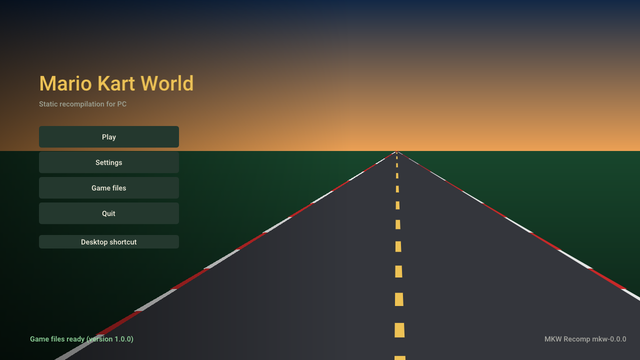

<!-- translated from README.md c71ca2cdc6f0 -->

<p align="center"></p>

<h1 align="center">mkw-recomp</h1>

<p align="center">
  <b>Mario Kart World (Nintendo Switch 2) recompilado para funcionar de forma nativa en Linux y Windows.</b>
</p>

<p align="center">
  <a href="https://github.com/adriadam10/mkw-recomp/releases/latest"></a>
  <a href="https://github.com/adriadam10/mkw-recomp/releases/latest"></a>
  <a href="https://github.com/adriadam10/mkw-recomp/releases/latest"></a>
</p>

<p align="center">
  <b><a href="https://github.com/adriadam10/mkw-recomp/releases">Versiones</a></b> ·
  <a href="../../CHANGELOG.md">Cambios</a> ·
  <a href="../../CONTRIBUTING.md">Contribuir</a> ·
  <a href="../../docs/research.md#sources">Fuentes</a> ·
  <a href="../../docs/roadmap.md">Hoja de ruta</a> ·
  <a href="../../docs/performance.md">Rendimiento</a> ·
  <a href="https://github.com/adriadam10/mkw-recomp/issues">Issues</a> ·
  <a href="https://github.com/adriadam10/mkw-recomp/discussions">Discussions</a> ·
  <a href="https://archive.org/search?query=subject%3A%22mkw-recomp%22">Archivo</a>
</p>

<!-- i18n-bar:start -->
<p align="center">
  <a href="../../README.md">English</a> ·
  <a href="README.zh-CN.md">简体中文</a> ·
  <b>Español</b> ·
  <a href="README.ar.md">العربية</a> ·
  <a href="README.hi.md">हिन्दी</a> ·
  <a href="README.pt-BR.md">Português (Brasil)</a> ·
  <a href="README.pt-PT.md">Português (Portugal)</a>
</p>
<!-- i18n-bar:end -->

Una recompilación estática de *Mario Kart World* (Nintendo Switch 2, versiones 1.0.0 y 1.8.0) en un programa nativo
de PC para Linux y Windows. Necesita tu propia copia del juego, volcada de tu propia consola: nada del juego está en
este repositorio ni en sus versiones publicadas.

**Es una recompilación, no un emulador.** El código AArch64 del juego se traduce a C de antemano y se compila para la
CPU del PC (x86-64, o AArch64 en Linux); no hay intérprete ni JIT de CPU. Tampoco se emula la GPU: NVN2, la API
gráfica de Switch 2, se reimplementa sobre Vulkan a nivel de API, y los shaders SM86 del juego se traducen a SPIR-V de
antemano. Las funciones del SDK de Nintendo (`nn::*`) se sustituyen por nombre con código propio.

## Estado

Temprano, y avanzando rápido. A 12/11/2026:

- Arranca, reproduce los vídeos de introducción, recorre los menús y corre carreras, en Linux y en Windows (x86-64), y
  en Linux sobre AArch64 (con su propio AppImage; probado en una consola portátil con Adreno 740).
- La pantalla de inicio prepara el juego a partir de tu copia en tu máquina (genera y compila el C, traduce los
  shaders, calienta la caché de pipelines) y guarda todos los ajustes: pantalla, calidad gráfica, controles, hacks.
- Las carreras van a 60 fps en GPU de gama alta y a 30 en las de gama media; ver [Rendimiento](#performance).
- Problemas conocidos: algunos menús (modo, selección de personaje y de vehículo) aún necesitan trabajo, la sombra del
  kart pierde un fotograma de vez en cuando, parte del audio se corta en los vídeos y con algunos drivers de AMD la GPU
  puede colgarse. No hay juego en línea.

## Hoja de ruta

El trabajo pendiente principal, por orden; los detalles están en [docs/roadmap.md](../../docs/roadmap.md).

- **60 fps en carrera.** Hoy un fotograma de carrera es una cadena en serie: el juego termina su fotograma (~3 ms\*),
  luego el back end de Vulkan graba el gran envío del juego (~19 ms\*), luego la GPU lo ejecuta (~10 ms\*), y solo
  entonces empieza el siguiente fotograma.
  Grabar está en el camino crítico, así que el trabajo es grabar con menos CPU: estado dinámico solo cuando cambia,
  cachés de dibujos entre fotogramas, grabación en paralelo y un hilo del juego más rápido.
- **La imagen como en la consola**: los últimos fallos del traductor de shaders, la sombra del kart, los push
  constants, cero errores de validación de Vulkan.
- **Todos los menús comprobados** contra la consola: los siguientes, modo y selección de personaje y de vehículo.
- **Sin cuelgues de GPU** y menos memoria de GPU; después, cargas sin tirones y un paquete de Linux para distribuciones
  que no son de actualización continua.
- **La 1.8.0 a la par de la 1.0.0**: su aspecto ultrapanorámico, el tamaño del mapa de sombras y la semilla fija
  ([#19](https://github.com/adriadam10/mkw-recomp/issues/19)).

\* Medido el 09/11/2026 en nuestra máquina de pruebas: APU Radeon 660M (Ryzen 5 7535HS), Linux, resolución interna
720p.

<a id="performance"></a>

## Rendimiento

Los tiempos por fotograma medidos, cada uno con su fecha, están en [docs/performance.md](../../docs/performance.md). Para
añadir tu máquina, abre un
[informe de rendimiento](https://github.com/adriadam10/mkw-recomp/issues/new?template=performance.yml): entra en la
tabla con la fecha del informe. Los tiempos son los fotogramas del propio juego: la generación de fotogramas muestra
más fotogramas pero no los acorta. 16,7 ms son 60 fps; con Fotogramas por segundo en Automático (lo de la consola)
baja a 30 fps cuando 60 no se alcanzan, y un fotograma de más de 33,3 ms hace que la carrera vaya más lenta que el
tiempo real.

| Fecha | GPU | Resolución interna | fps en carrera | Tiempo por fotograma |
|---|---|---|---|---|
| 11/11/2026 | RX 7900 XTX (Windows) | 2160p | 60 | 16,7 ms |
| 11/11/2026 | RX 9070 XT (Linux, RADV) | 720p a 2160p | 60 | 16,7 ms |
| 10/11/2026 | RTX 3060 (Windows) | 1080p | ~48 | ~21 ms |
| 11/11/2026 | RTX 3050 Laptop (Windows) | 720p | ~37 | 26,7 ms |
| 09/11/2026 | Radeon 660M (Linux, RADV) | 720p | 30-32 | 31-33 ms |
| 11/11/2026 | GTX 1650 SUPER (Windows) | 1080p | ~24 | ~41 ms |
| 09/11/2026 | GTX 1050 Ti (Windows) | 1080p | 22-24 | 42-45 ms |

## Cómo jugar




1. Vuelca Mario Kart World 1.0.0 o 1.8.0 de tu Switch 2 (`exefs/` y `romfs/`, descifrados; la 1.8.0 con la
   actualización integrada en la RomFS del juego base), o ese mismo volcado empaquetado en un único archivo `.nup` o
   `.nx`.
2. Descarga el lanzador para tu sistema desde [Versiones](https://github.com/adriadam10/mkw-recomp/releases): en Linux
   el `.AppImage` (`-aarch64` en ARM; la carpeta del juego por defecto es `~/.local/share/mkw-recomp`; glibc 2.31 o
   posterior: Debian 11, Ubuntu 20.04, SteamOS y posteriores), en Windows el `.zip`, descomprimido en una carpeta. En
   los dos hacen falta unos 30 GB libres.
3. Ejecuta el AppImage (antes, `chmod +x`) o `mkw.exe`, abre **Ficheros del juego**, si quieres elige con **Elegir
   carpeta del juego** dónde se instalará el juego (o una instalación que ya exista), indica tu volcado (**Elegir
   carpeta** o **Elegir archivo .nup o .nx**) y pulsa **Preparar**. El lanzador recuerda la carpeta de instalación; ahí
   viven el juego compilado, los ficheros preparados, las partidas guardadas, los ajustes y las cachés. Elegir otra
   carpeta deja los ficheros existentes donde están.
   La primera preparación tarda un rato (compila el juego entero y descarga `nvdisasm` y `ptxas` de NVIDIA, 84 MB en
   Linux y 126 MB en Windows, para describir la codificación de los shaders en tu máquina); después, **Jugar**.
4. Cuando sale una versión nueva, la pantalla de inicio la ofrece (**Actualizar a vX**): la descarga, la comprueba,
   sustituye el programa y vuelve a preparar solo lo que cambió. **Configuración → Menú → Buscar actualizaciones** lo
   desactiva.

Requisitos: CPU x86-64 con AVX2 (o, en Linux, AArch64 con ARMv8.2: LSE, FP16, RCpc, DotProd, CRC32), una GPU con
Vulkan 1.3 (se recomienda `VK_EXT_mesh_shader`; sin ella, los task y mesh shaders se ejecutan como compute) y 16 GB de
RAM recomendados. En un contenedor Docker o Podman en Linux, permite `userfaultfd` en su perfil seccomp (el de Docker
lo rechaza por defecto): sin él, el port no sabe qué memoria del juego cambió y va varias veces más lento.

## Funciones extra

Más allá de la consola, todas opcionales y desactivadas (o al valor de la consola) por defecto:

- **Pantalla**: resolución interna por encima o por debajo de la de la consola, 21:9, 32:9 y 48:9 (las carreras muestran más
  a los lados), escalado AMD FSR 1, HDR en pantallas HDR, VSync, presentación mailbox o inmediata.
- **Generación de fotogramas**: fotogramas intercalados entre los del juego (una carrera a 30 fps mostrada a 60, o a
  240 en una pantalla de 240 Hz). Más fluido, no más rápido: la imagen llega hasta un fotograma más tarde, y el
  movimiento rápido y el minimapa pueden emborronarse.
- **Gráficos**: filtrado y calidad de texturas, distancia de detalle y calidad de sombras por encima o por debajo de
  las de la consola.
- **Sonido**: sonido envolvente 5.1.
- **Controles**: todas las teclas y botones reasignables, cámara con el ratón, iconos de botones de Nintendo, Xbox o
  PlayStation, dirección por movimiento, intensidad de la vibración; multijugador local con un mando cada uno.
  Los mandos de Switch 2 (Pro Controller, Joy-Con, GameCube) funcionan por Bluetooth y, en Linux, por USB; en Windows
  el USB necesita un paso único con el controlador, más abajo.
- **Hacks**: turbo (mantener o alternar F2), saltar vídeos, desbloquearlo todo, la misma aleatoriedad cada vez,
  directo a contrarreloj o a modo libre.
- **Idiomas**: los menús en 20 idiomas; el propio juego también en catalán, gallego y euskera.
- **Ficheros del juego**: elegir la carpeta de instalación; un volcado en carpetas o en un único archivo `.nup` o
  `.nx`, usado donde está; actualizaciones desde la pantalla de inicio.
- **Superposición de rendimiento** (FPS, o CPU, GPU y memoria al completo) e información del sistema en un clic para
  los informes de fallos.

### Mandos de Switch 2 por USB en Windows

Estos mandos solo arrancan tras una orden enviada a su segunda interfaz USB, que Windows deja sin un controlador que
una aplicación pueda usar. Una vez por mando, con [Zadig](https://zadig.akeo.ie/):

1. Conecta el mando con un cable USB-C y abre Zadig.
2. **Options → List All Devices**, y elige la **Interface 1** del mando (ID USB `057E` y `2069` para el Pro
   Controller, `2066`/`2067` para el Joy-Con derecho/izquierdo, `2073` para el mando de GameCube). No la Interface 0:
   esa es la entrada normal del mando, y sustituirla lo oculta a todas las demás aplicaciones.
3. Controlador **WinUSB**, y **Replace Driver** (o **Install Driver**).

Lo mismo vale para un mando virtual que aparezca con esos ID USB (el modo USB/IP de Switch2Connect). Para deshacerlo,
desinstala el dispositivo de esa interfaz en el Administrador de dispositivos con «eliminar el controlador» marcado.

## Mods

La página **Mods** de la pantalla de inicio instala los mods tal como se publican para el juego y los lista en dos
pestañas:

- **Buscar en GameBanana**: los mods de Mario Kart World en [GameBanana](https://gamebanana.com/games/22152), listados
  o buscados, con el autor, la licencia, las capturas y la descripción de cada uno. **Instalar** descarga el archivo
  de GameBanana, solo cuando lo pides.
- **Instalados**: tus mods, cada uno con su interruptor; **Importar zip / Importar carpeta** toma un mod que ya tengas
  (`.zip`, `.rar` o `.7z`, con `romfs/` y/o `exefs/` en cualquier parte, también con la estructura
  `atmosphere/contents/`).

Los mods que sustituyen ficheros del juego (`romfs/`: skins, texturas, textos, circuitos) se aplican en el siguiente
arranque. Los que cambian el código del juego (parches `.ips` o `.pchtxt` de `exefs/`, como 200cc o 30 FPS) se
integran en el código del juego: activar o desactivar uno lo recompila antes de jugar (unos minutos). Dos mods que
cambian el mismo archivo se combinan fichero a fichero, y la página pregunta cuál gana donde los dos cambian el mismo
fichero. La página avisa de los mods que sustituyen los ajustes gráficos o los shaders del juego, que el port gestiona
a su manera.

Los mods los hacen otras personas y este proyecto no los prueba: uno puede colgar el juego o dañar tu partida
guardada. Lee la página de un mod antes de instalarlo, guarda una copia de tu partida y comunica los problemas de un
mod a su autor; cuando informes de un fallo aquí, di qué mods estaban activados (el log los lista), o prueba antes sin
ellos.

## Compilar desde el código fuente

Linux, con `uv`, `clang`, `lld`, `ninja`, SDL3, Opus, libvpx, zstd, xxHash, las cabeceras de Vulkan y VMA 3.4.0
(detalles en [tools/build/README.md](../../tools/build/README.md)). Pon tu volcado en `game/` (`game/exefs`, `game/romfs`) o
define `MKW_GAME=<dir>`, y desde la raíz del repositorio:

```sh
uv run python recomp/gen.py --exefs game/exefs --out build/generated --jobs 8 --patches recomp/patches-mkw.txt  # 1.8.0: patches-mkw-180.txt
uv run tools/shaders/extract.py && uv run tools/shaders/translate.py
uv run tools/build/build.py              # build/mkw; --target windows compila mkw.exe con llvm-mingw
build/mkw
```

Desde un volcado empaquetado (`.nup`, `.nx`) y para Linux en AArch64:
[tools/build/README.md](../../tools/build/README.md#a-packed-dump) y [su sección AArch64](../../tools/build/README.md#linux-aarch64).

Traducir los shaders necesita la especificación de la codificación SM86, generada a partir de `nvdisasm` de NVIDIA (no
se distribuye): ver [tools/shaders/README.md](../../tools/shaders/README.md). Todo lo generado va a `build/`, nunca a git.

| Carpeta | Contenido |
|---|---|
| [recomp/](../../recomp/README.md) | El generador: AArch64 → C |
| [runtime/](../../runtime/README.md) | Lo que hace de consola: kernel, memoria, sustitutos del SDK, NVN2 sobre Vulkan, audio, entrada, menús y lanzador |
| [sm86/](../../sm86/README.md) | El traductor de shaders: SASS SM86 → GLSL → SPIR-V |
| [i18n/](../../i18n/README.md) | Los textos de los menús, de la pantalla de inicio y de la preparación en todos los idiomas (gettext `.po`) |
| [tools/](../../tools/README.md) | Análisis, preparación, compilación, partidas y diagnósticos |
| [tests/](../../tests/README.md) | Pruebas sin el juego ni GPU, en el CI de Linux y Windows |
| [docs/](../../docs/README.md) | Investigación, fuentes y rendimiento |
| `.github/` | CI, plantillas de issues y de pull requests |

En la raíz: `pyproject.toml` y `uv.lock` (el entorno Python de las herramientas), `.gitignore`, `LICENSE`,
`CONTRIBUTING.md`, `CHANGELOG.md` (los cambios de cada versión, sus notas) y `AGENTS.md` (una guía para agentes de
programación).

## Decisiones de diseño (30/10/2026)

| Tema | Decisión | Por qué |
|---|---|---|
| CPU | Traductor AArch64→C basado en el de [totk-pc-recomp](https://github.com/valentderah/totk-pc-recomp) (MIT), ampliado a ARMv8.1-8.3: atómicos LSE, CAS, LDAPR; PAC como identidad, etiquetas MTE a 0 | La misma familia de motor que MKW, y ya escala a un ejecutable grande |
| Sistema | Las funciones `nn::*` del SDK sustituidas por nombre; las firmas, de los nombres decorados de los 1 289 imports de `main` | No hay servicios de la consola que emular |
| Gráficos | NVN2 sobre Vulkan: 529 de sus 699 funciones comparten nombre con NVN1 (firmas conocidas por totk-pc-recomp y nxnative); 170 son nuevas | Recompilación, no emulación de la GPU |
| Shaders | Traductor propio SM86→SPIR-V, sin conexión, con un decodificador generado a partir de la especificación de DocumentSASS / nvsass-disassembler | Cubre mesh/task y lo que le falta a Maxwell |
| Funciones opcionales de Switch 2 | HDR activado por sí solo cuando la pantalla está en HDR, como en la consola (Configuración > Pantalla > HDR: Automático o No); DLSS, trazado de rayos y táctil tras opciones, desactivados por defecto; desactivados, sus funciones de NVN2 existen pero no hacen nada, para que el juego siga su camino normal | Extras del hardware de la consola, no hacen falta para jugar |
| Valores por defecto | El aspecto y la resolución de la consola; los ajustes más bajos son opciones | Elige el jugador |

## Cómo se hizo

Este port se escribió con [Claude](https://claude.com/claude-code) (el agente de programación de Anthropic) haciendo
la mayor parte del tecleo, bajo mi dirección, en unos diez días de trabajo a tiempo completo: 489 commits desde el
30/10/2026, cada uno revisado, medido o probado antes de entrar. No fue un prompt y listo. Detrás hay:

- **Método más que prompts.** Cada cambio de rendimiento se midió con un A/B dentro de la misma partida (dos partidas
  del mismo binario difieren hasta 12 ms por fotograma); cada arreglo de imagen se comprobó contra la imagen de la
  propia consola; los cambios del traductor de shaders se prueban fuera de la GPU en cada uno de los 11 561 programas
  de MKW antes de una partida; las capturas de fotogramas reproducen el back end en segundos sin el juego. Las reglas
  que salieron de los errores están escritas y las hacen cumplir scripts, para que el mismo error no se repita.
- **Lo que había aprendido antes.** El recompilador y el runtime crecieron a partir de
  [totk-pc-recomp](https://github.com/valentderah/totk-pc-recomp) y su port a Linux, y de mi trabajo anterior en otros
  recomps (SavageWindRecomp, smo-recomp): el traductor, el lanzador y la preparación que compila el juego en la
  máquina del jugador, los iconos de botones, el flujo de control de los shaders. Como mantenedor de
  [AnyPS5](https://github.com/boykopovar/AnyPS5) aprendí a traducir shaders de GPU con fidelidad, a ejecutar mesh
  shaders como compute en GPU que no los tienen y a mantener honesto un proyecto grande con comprobaciones y medidas.
- **La investigación de la comunidad.** Las notas de [eden-nx2](https://git.eden-emu.dev/Takoroka/eden-nx2) sobre
  Switch 2, la codificación SASS de NVIDIA tal como la documentan DocumentSASS y nvsass-disassembler, Ryujinx y Mesa
  NAK para la semántica de los shaders, y los demás ports de Switch 2 listados en las fuentes.

## Licencias y créditos

Este proyecto está bajo la [Licencia MIT](../../LICENSE). El código tomado de otros proyectos conserva su propia licencia,
junto a él (ficheros `LICENSE.*` en [recomp/](../../recomp/), [runtime/](../../runtime/), [sm86/decode/](../../sm86/decode/) y
[runtime/third_party/](../../runtime/third_party/README.md)): totk-pc-recomp, nvsass-disassembler, Dear ImGui, bc7enc,
stb_image, AMD FidelityFX FSR 1 y Roboto. Cada fuente usada, con su licencia y lo que se tomó de ella (código solo de
proyectos MIT; de proyectos GPL, solo ideas), está listada en [docs/research.md](../../docs/research.md#sources).

Mario Kart World es © Nintendo. Este proyecto no está afiliado ni respaldado por Nintendo, no contiene código ni
recursos del juego y no ayuda a obtenerlos.

Los mods pertenecen a sus autores y tienen sus propias licencias. Este proyecto no está afiliado ni respaldado por
GameBanana ni por el autor de ningún mod, no aloja, revisa ni distribuye mods, y no es responsable de lo que haga un
mod: la pantalla de inicio solo muestra el listado público de GameBanana y descarga un mod de GameBanana cuando se lo
pides.

## Contribuir

Ver [CONTRIBUTING.md](../../CONTRIBUTING.md). Los fallos y los informes de rendimiento van a
[Issues](https://github.com/adriadam10/mkw-recomp/issues), las preguntas a
[Discussions](https://github.com/adriadam10/mkw-recomp/discussions).
