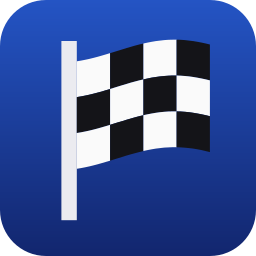
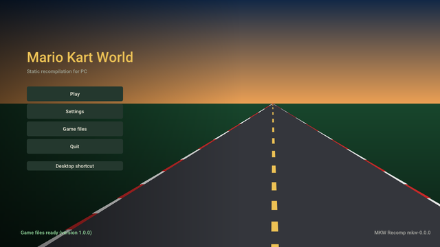

<!-- translated from README.md c71ca2cdc6f0 -->

<p align="center"></p>

<h1 align="center">mkw-recomp</h1>

<p align="center">
  <b>Mario Kart World (Nintendo Switch 2), Linux और Windows पर नेटिव रूप से चलने के लिए रीकम्पाइल किया गया।</b>
</p>

<p align="center">
  <a href="https://github.com/adriadam10/mkw-recomp/releases/latest"></a>
  <a href="https://github.com/adriadam10/mkw-recomp/releases/latest"></a>
  <a href="https://github.com/adriadam10/mkw-recomp/releases/latest"></a>
</p>

<p align="center">
  <b><a href="https://github.com/adriadam10/mkw-recomp/releases">रिलीज़</a></b> ·
  <a href="../../CHANGELOG.md">बदलाव</a> ·
  <a href="../../CONTRIBUTING.md">योगदान</a> ·
  <a href="../../docs/research.md#sources">स्रोत</a> ·
  <a href="../../docs/roadmap.md">रोडमैप</a> ·
  <a href="../../docs/performance.md">प्रदर्शन</a> ·
  <a href="https://github.com/adriadam10/mkw-recomp/issues">इश्यू</a> ·
  <a href="https://github.com/adriadam10/mkw-recomp/discussions">चर्चाएँ</a> ·
  <a href="https://archive.org/search?query=subject%3A%22mkw-recomp%22">आर्काइव</a>
</p>

<!-- i18n-bar:start -->
<p align="center">
  <a href="../../README.md">English</a> ·
  <a href="README.zh-CN.md">简体中文</a> ·
  <a href="README.es.md">Español</a> ·
  <a href="README.ar.md">العربية</a> ·
  <b>हिन्दी</b> ·
  <a href="README.pt-BR.md">Português (Brasil)</a> ·
  <a href="README.pt-PT.md">Português (Portugal)</a>
</p>
<!-- i18n-bar:end -->

*Mario Kart World* (Nintendo Switch 2, संस्करण 1.0.0 और 1.8.0) का स्टैटिक रीकम्पाइलेशन, Linux और Windows के लिए एक नेटिव PC
प्रोग्राम के रूप में। इसके लिए आपको गेम की अपनी कॉपी चाहिए, जो आपने अपने कंसोल से डंप की हो: गेम का कुछ भी इस रिपॉज़िटरी या
इसकी रिलीज़ में शामिल नहीं है।

**यह रीकम्पाइलेशन है, एम्युलेटर नहीं।** गेम का AArch64 कोड पहले से C में अनुवादित किया जाता है और PC के CPU (x86-64, या Linux
पर AArch64) के लिए कम्पाइल किया जाता है; कोई CPU इंटरप्रेटर या JIT नहीं है। GPU भी एम्युलेट नहीं होता: Switch 2 का ग्राफ़िक्स
API, NVN2, API स्तर पर Vulkan के ऊपर दोबारा लागू किया गया है, और गेम के SM86 शेडर पहले से SPIR-V में अनुवादित किए जाते हैं।
Nintendo SDK के फ़ंक्शन (`nn::*`) नाम से हमारे अपने कोड से बदल दिए जाते हैं।

## स्थिति

शुरुआती दौर में, और तेज़ी से आगे बढ़ रहा है। 12/11/2026 तक:

- यह बूट होता है, शुरुआती वीडियो चलाता है, मेनू से गुज़रता है और रेस चलाता है, Linux और Windows (x86-64) पर, और AArch64 पर
  Linux में (इसकी अपनी AppImage के साथ; Adreno 740 वाले हैंडहेल्ड पर परखा गया)।
- स्टार्ट स्क्रीन आपकी मशीन पर आपकी कॉपी से गेम सेट अप करती है (C बनाती और कम्पाइल करती है, शेडर का अनुवाद करती है,
  पाइपलाइन कैश गर्म करती है) और हर सेटिंग संभालती है: डिस्प्ले, ग्राफ़िक्स गुणवत्ता, कंट्रोल, हैक्स।
- हाई-एंड GPU पर रेस 60 fps पर और मिड-रेंज पर 30 पर चलती है; देखें [प्रदर्शन](#performance)।
- ज्ञात समस्याएँ: कुछ मेनू (मोड, कैरेक्टर और व्हीकल चयन) पर अभी काम बाकी है, कार्ट की छाया कभी-कभी एक फ़्रेम छोड़ देती है,
  वीडियो में कुछ ऑडियो कट जाता है, और कुछ AMD ड्राइवरों पर GPU अटक सकता है। ऑनलाइन खेल नहीं है।

## रोडमैप

मुख्य बाकी काम, प्राथमिकता के क्रम में; विवरण [docs/roadmap.md](../../docs/roadmap.md) में हैं।

- **रेस में 60 fps।** आज रेस का एक फ़्रेम एक क्रमिक श्रृंखला है: गेम अपना फ़्रेम पूरा करता है (~3 ms\*), फिर Vulkan बैक एंड गेम
  का बड़ा सबमिट रिकॉर्ड करता है (~19 ms\*), फिर GPU उसे चलाता है (~10 ms\*), और उसके बाद ही अगला फ़्रेम शुरू होता है।
  रिकॉर्डिंग क्रिटिकल पाथ पर है, इसलिए काम है कम CPU से रिकॉर्ड करना: डायनेमिक स्टेट केवल बदलने पर, फ़्रेमों के बीच ड्रॉ कैश,
  समानांतर रिकॉर्डिंग, और तेज़ गेम थ्रेड।
- **कंसोल जैसी तस्वीर**: शेडर अनुवादक की आख़िरी गड़बड़ियाँ, कार्ट की छाया, push constants, Vulkan वैलिडेशन की शून्य त्रुटियाँ।
- **हर मेनू** कंसोल से मिलाकर जाँचा गया: अगले हैं मोड, कैरेक्टर और व्हीकल चयन।
- **कोई GPU हैंग नहीं** और कम GPU मेमोरी, फिर बिना अटके लोडिंग और गैर-रोलिंग डिस्ट्रीब्यूशन के लिए एक Linux पैकेज।
- **1.8.0, 1.0.0 के बराबर**: उसका अल्ट्रावाइड आस्पेक्ट, शैडो मैप का आकार और स्थिर सीड
  ([#19](https://github.com/adriadam10/mkw-recomp/issues/19))।

\* 09/11/2026 को हमारी परीक्षण मशीन पर मापा गया: Radeon 660M APU (Ryzen 5 7535HS), Linux, 720p आंतरिक रिज़ॉल्यूशन।

<a id="performance"></a>

## प्रदर्शन

मापे गए फ़्रेम समय, हर एक अपनी तारीख़ के साथ, [docs/performance.md](../../docs/performance.md) में हैं। अपनी मशीन जोड़ने के लिए एक
[प्रदर्शन रिपोर्ट](https://github.com/adriadam10/mkw-recomp/issues/new?template=performance.yml) खोलें: वह रिपोर्ट की तारीख़
के साथ तालिका में जुड़ जाती है। ये समय गेम के अपने फ़्रेम हैं: फ़्रेम जनरेशन ज़्यादा फ़्रेम दिखाता है पर उन्हें छोटा नहीं करता।
16.7 ms यानी 60 fps; Frame rate को Automatic (कंसोल वाला) पर रखने पर 60 न पहुँचने पर यह 30 fps पर आ जाता है, और 33.3 ms से
लंबा फ़्रेम रेस को असली समय से धीमा चलाता है।

| तारीख़ | GPU | आंतरिक रिज़ॉल्यूशन | रेस fps | रेस फ़्रेम समय |
|---|---|---|---|---|
| 11/11/2026 | RX 7900 XTX (Windows) | 2160p | 60 | 16.7 ms |
| 11/11/2026 | RX 9070 XT (Linux, RADV) | 720p से 2160p | 60 | 16.7 ms |
| 10/11/2026 | RTX 3060 (Windows) | 1080p | ~48 | ~21 ms |
| 11/11/2026 | RTX 3050 Laptop (Windows) | 720p | ~37 | 26.7 ms |
| 09/11/2026 | Radeon 660M (Linux, RADV) | 720p | 30-32 | 31-33 ms |
| 11/11/2026 | GTX 1650 SUPER (Windows) | 1080p | ~24 | ~41 ms |
| 09/11/2026 | GTX 1050 Ti (Windows) | 1080p | 22-24 | 42-45 ms |

## खेलना




1. अपने Switch 2 से Mario Kart World 1.0.0 या 1.8.0 डंप करें (`exefs/` और `romfs/`, डिक्रिप्ट किए हुए; 1.8.0 में अपडेट बेस गेम
   की RomFS में मिला हुआ), या वही डंप एक `.nup` या `.nx` फ़ाइल में पैक किया हुआ।
2. [Releases](https://github.com/adriadam10/mkw-recomp/releases) से अपने सिस्टम के लिए लॉन्चर डाउनलोड करें: Linux पर
   `.AppImage` (ARM पर `-aarch64`; डिफ़ॉल्ट गेम फ़ोल्डर `~/.local/share/mkw-recomp` है; glibc 2.31 या नया: Debian 11,
   Ubuntu 20.04, SteamOS और उसके बाद के), Windows पर `.zip`, एक फ़ोल्डर में अनज़िप करके। दोनों के लिए लगभग 30 GB ख़ाली जगह
   चाहिए।
3. AppImage (पहले `chmod +x`) या `mkw.exe` चलाएँ, **Game files** खोलें, चाहें तो **Choose game folder** से चुनें कि गेम कहाँ
   इंस्टॉल होगा (या कोई पहले से मौजूद इंस्टॉलेशन), फिर अपना डंप चुनें (**Choose folder** या **Choose .nup or .nx file**)
   और **Set up** दबाएँ। लॉन्चर इंस्टॉलेशन फ़ोल्डर याद रखता है; कम्पाइल किया गया गेम, तैयार फ़ाइलें, सेव, सेटिंग्स और कैश वहीं
   रहते हैं। दूसरा फ़ोल्डर चुनने से मौजूदा फ़ाइलें अपनी जगह रहती हैं।
   पहला सेटअप कुछ समय लेता है (यह पूरा गेम कम्पाइल करता है और आपकी मशीन पर शेडर एन्कोडिंग बताने के लिए NVIDIA के `nvdisasm`
   और `ptxas` डाउनलोड करता है, Linux पर 84 MB और Windows पर 126 MB); उसके बाद, **Play**।
4. नई रिलीज़ आने पर स्टार्ट स्क्रीन उसे पेश करती है (**Update to vX**): वह उसे डाउनलोड करती है, जाँचती है, प्रोग्राम बदलती है और
   सिर्फ़ जो बदला उसे दोबारा सेट अप करती है। **Settings → Menu → Check for updates** इस जाँच को बंद करता है।

ज़रूरतें: AVX2 वाला x86-64 CPU (या Linux पर ARMv8.2 वाला AArch64: LSE, FP16, RCpc, DotProd, CRC32), Vulkan 1.3 वाला GPU
(`VK_EXT_mesh_shader` अनुशंसित; इसके बिना task और mesh शेडर compute के रूप में चलते हैं), 16 GB RAM अनुशंसित। Linux पर Docker
या Podman कंटेनर में, उसकी seccomp प्रोफ़ाइल में `userfaultfd` की अनुमति दें (Docker का डिफ़ॉल्ट इसे मना करता है): इसके बिना
पोर्ट यह नहीं जान पाता कि गेम की कौन-सी मेमोरी बदली, और कई गुना धीमा चलता है।

## अतिरिक्त सुविधाएँ

कंसोल से आगे की, सब वैकल्पिक और डिफ़ॉल्ट रूप से बंद (या कंसोल के मान पर):

- **डिस्प्ले**: कंसोल से ऊपर या नीचे का आंतरिक रिज़ॉल्यूशन, 21:9, 32:9 और 48:9 (रेस में किनारों पर ज़्यादा दिखता है), AMD FSR 1
  स्केलिंग, HDR स्क्रीन पर HDR, VSync, mailbox या immediate प्रेज़ेंटेशन।
- **फ़्रेम जनरेशन**: गेम के फ़्रेमों के बीच बनाए गए फ़्रेम (30 fps की रेस 60 पर, या 240 Hz स्क्रीन पर 240 पर दिखाई जाती है)।
  ज़्यादा स्मूथ, तेज़ नहीं: तस्वीर एक फ़्रेम तक देर से आती है, और तेज़ गति और मिनीमैप धुँधले हो सकते हैं।
- **ग्राफ़िक्स**: टेक्सचर फ़िल्टरिंग और गुणवत्ता, डिटेल दूरी और छाया गुणवत्ता, कंसोल से ऊपर या नीचे।
- **ध्वनि**: 5.1 सराउंड।
- **कंट्रोल**: हर कुंजी और बटन फिर से असाइन करने योग्य, माउस कैमरा, Nintendo, Xbox या PlayStation बटन आइकन, मोशन स्टीयरिंग,
  वाइब्रेशन की तीव्रता; हर खिलाड़ी के लिए एक कंट्रोलर के साथ लोकल मल्टीप्लेयर। Switch 2 के कंट्रोलर (Pro Controller,
  Joy-Con, GameCube) Bluetooth से और Linux पर USB से भी चलते हैं; Windows पर USB के लिए एक बार का ड्राइवर चरण चाहिए, नीचे।
- **हैक्स**: टर्बो (F2 दबाए रखें या टॉगल करें), वीडियो छोड़ें, सब कुछ अनलॉक करें, हर बार एक जैसी रैंडमनेस, सीधे टाइम ट्रायल या
  फ़्री रोम पर।
- **भाषाएँ**: मेनू 20 भाषाओं में; गेम ख़ुद कैटलन, गैलिशियन और बास्क में भी।
- **गेम फ़ाइलें**: इंस्टॉलेशन फ़ोल्डर चुनें; फ़ोल्डरों के रूप में या एक `.nup` या `.nx` फ़ाइल के रूप में डंप, जहाँ है वहीं से
  इस्तेमाल; स्टार्ट स्क्रीन से अपडेट।
- **प्रदर्शन ओवरले** (FPS, या पूरा CPU, GPU और मेमोरी) और बग रिपोर्ट के लिए एक क्लिक में सिस्टम जानकारी।

### Windows पर USB से Switch 2 कंट्रोलर

ये कंट्रोलर तभी शुरू होते हैं जब उनके दूसरे USB इंटरफ़ेस को एक कमांड भेजी जाए, और Windows उस इंटरफ़ेस पर कोई ऐसा ड्राइवर
नहीं रखता जिसे कोई ऐप इस्तेमाल कर सके। हर कंट्रोलर के लिए एक बार, [Zadig](https://zadig.akeo.ie/) से:

1. कंट्रोलर को USB-C केबल से जोड़ें और Zadig खोलें।
2. **Options → List All Devices**, फिर कंट्रोलर का **Interface 1** चुनें (USB ID: Pro Controller के लिए `057E` और `2069`,
   दाएँ/बाएँ Joy-Con के लिए `2066`/`2067`, GameCube कंट्रोलर के लिए `2073`)। Interface 0 नहीं: वह कंट्रोलर का सामान्य
   इनपुट है, और उसे बदलने से कंट्रोलर बाकी सभी ऐप्स से छिप जाता है।
3. ड्राइवर **WinUSB**, फिर **Replace Driver** (या **Install Driver**)।

यही चरण उस वर्चुअल कंट्रोलर पर भी लागू होते हैं जो इन्हीं USB ID के साथ दिखता है (Switch2Connect का USB/IP मोड)। वापस करने
के लिए, Device Manager में उस इंटरफ़ेस का डिवाइस "delete the driver" टिक करके अनइंस्टॉल करें।

## मॉड

स्टार्ट स्क्रीन का **Mods** पेज मॉड वैसे ही इंस्टॉल करता है जैसे वे गेम के लिए प्रकाशित होते हैं, और उन्हें दो टैब में दिखाता है:

- **Find on GameBanana**: [GameBanana](https://gamebanana.com/games/22152) पर Mario Kart World के मॉड, सूची या खोज के ज़रिए,
  हर मॉड के लेखक, लाइसेंस, स्क्रीनशॉट और विवरण के साथ। **Install** फ़ाइल GameBanana से डाउनलोड करता है, सिर्फ़ तब जब आप कहें।
- **Installed**: आपके मॉड, हर एक का अपना ऑन/ऑफ़ स्विच; **Import zip / Import folder** आपके पास पहले से मौजूद मॉड लेता है
  (`.zip`, `.rar` या `.7z`, जिसमें कहीं भी `romfs/` और/या `exefs/` हो, `atmosphere/contents/` ढाँचे सहित)।

जो मॉड गेम फ़ाइलें बदलते हैं (`romfs/`: स्किन, टेक्सचर, टेक्स्ट, ट्रैक) वे अगली शुरुआत पर लागू होते हैं। जो मॉड गेम का कोड बदलते
हैं (`exefs/` के `.ips` या `.pchtxt` पैच, जैसे 200cc या 30 FPS) वे गेम कोड में जोड़े जाते हैं: किसी एक को चालू या बंद करने पर
खेलने से पहले गेम दोबारा कम्पाइल होता है (कुछ मिनट)। एक ही आर्काइव बदलने वाले दो मॉड फ़ाइल-दर-फ़ाइल मिलाए जाते हैं, और जहाँ दोनों
एक ही फ़ाइल बदलते हैं वहाँ पेज पूछता है कि कौन-सा लागू हो। पेज उन मॉड के बारे में चेतावनी देता है जो गेम की ग्राफ़िक्स सेटिंग या
शेडर बदलते हैं, जिन्हें पोर्ट अपने तरीक़े से संभालता है।

मॉड दूसरे लोग बनाते हैं और यह प्रोजेक्ट उनका परीक्षण नहीं करता: कोई मॉड गेम क्रैश कर सकता है या आपका सेव ख़राब कर सकता है।
इंस्टॉल करने से पहले मॉड का पेज पढ़ें, अपने सेव की कॉपी रखें, और मॉड की समस्याएँ उसके लेखक को बताएँ; यहाँ बग रिपोर्ट करते समय
बताएँ कि कौन-से मॉड चालू थे (लॉग में उनकी सूची होती है), या पहले उनके बिना फिर से आज़माएँ।

## सोर्स से बिल्ड करना

Linux, `uv`, `clang`, `lld`, `ninja`, SDL3, Opus, libvpx, zstd, xxHash, Vulkan हेडर और VMA 3.4.0 के साथ (विवरण
[tools/build/README.md](../../tools/build/README.md) में)। अपना डंप `game/` (`game/exefs`, `game/romfs`) में रखें या
`MKW_GAME=<dir>` सेट करें, फिर रिपॉज़िटरी की जड़ से:

```sh
uv run python recomp/gen.py --exefs game/exefs --out build/generated --jobs 8 --patches recomp/patches-mkw.txt  # 1.8.0: patches-mkw-180.txt
uv run tools/shaders/extract.py && uv run tools/shaders/translate.py
uv run tools/build/build.py              # build/mkw; --target windows builds mkw.exe with llvm-mingw
build/mkw
```

पैक किए गए डंप (`.nup`, `.nx`) से और AArch64 पर Linux के लिए: [tools/build/README.md](../../tools/build/README.md#a-packed-dump)
और [उसका AArch64 हिस्सा](../../tools/build/README.md#linux-aarch64)।

शेडर का अनुवाद करने के लिए SM86 एन्कोडिंग का विनिर्देश चाहिए, जो NVIDIA के `nvdisasm` से बनाया जाता है (साथ में नहीं दिया जाता):
देखें [tools/shaders/README.md](../../tools/shaders/README.md)। जो कुछ बनाया जाता है वह `build/` में जाता है, git में कभी नहीं।

| फ़ोल्डर | सामग्री |
|---|---|
| [recomp/](../../recomp/README.md) | जनरेटर: AArch64 → C |
| [runtime/](../../runtime/README.md) | जो कंसोल की भूमिका निभाता है: कर्नेल, मेमोरी, SDK के विकल्प, Vulkan पर NVN2, ऑडियो, इनपुट, मेनू और लॉन्चर |
| [sm86/](../../sm86/README.md) | शेडर अनुवादक: SM86 SASS → GLSL → SPIR-V |
| [i18n/](../../i18n/README.md) | मेनू, स्टार्ट स्क्रीन और सेटअप के टेक्स्ट हर भाषा में (gettext `.po`) |
| [tools/](../../tools/README.md) | विश्लेषण, सेटअप, बिल्ड, गेम रन और डायग्नोस्टिक्स |
| [tests/](../../tests/README.md) | गेम या GPU के बिना परीक्षण, Linux और Windows के CI में |
| [docs/](../../docs/README.md) | शोध, स्रोत और प्रदर्शन |
| `.github/` | CI, issue और pull request टेम्पलेट |

जड़ में: `pyproject.toml` और `uv.lock` (टूल्स का Python वातावरण), `.gitignore`, `LICENSE`, `CONTRIBUTING.md`,
`CHANGELOG.md` (हर रिलीज़ के बदलाव, उसके नोट्स) और `AGENTS.md` (कोडिंग एजेंटों के लिए गाइड)।

## डिज़ाइन निर्णय (30/10/2026)

| विषय | निर्णय | क्यों |
|---|---|---|
| CPU | [totk-pc-recomp](https://github.com/valentderah/totk-pc-recomp) (MIT) पर आधारित AArch64→C अनुवादक, ARMv8.1-8.3 तक बढ़ाया गया: LSE एटॉमिक्स, CAS, LDAPR; PAC को identity, MTE टैग को 0 | MKW वाले ही इंजन परिवार का, और पहले से बड़े एक्ज़ीक्यूटेबल तक स्केल करता है |
| सिस्टम | SDK के `nn::*` फ़ंक्शन नाम से बदले गए; सिग्नेचर `main` के 1 289 इम्पोर्ट के मैंगल्ड नामों से | कंसोल की कोई सेवा एम्युलेट नहीं करनी |
| ग्राफ़िक्स | Vulkan पर NVN2: इसके 699 में से 529 फ़ंक्शन का नाम NVN1 जैसा है (सिग्नेचर totk-pc-recomp और nxnative से ज्ञात); 170 नए हैं | रीकम्पाइलेशन, GPU एम्युलेशन नहीं |
| शेडर | हमारा अपना ऑफ़लाइन SM86→SPIR-V अनुवादक, DocumentSASS / nvsass-disassembler विनिर्देश से बने डिकोडर के साथ | mesh/task और Maxwell में जो नहीं है उसे कवर करता है |
| Switch 2 की वैकल्पिक सुविधाएँ | डिस्प्ले HDR में हो तो HDR अपने आप चालू, कंसोल की तरह (Settings > Screen > HDR: Automatic या Off); DLSS, रे ट्रेसिंग और टच विकल्पों के पीछे, डिफ़ॉल्ट रूप से बंद; बंद होने पर उनके NVN2 फ़ंक्शन मौजूद रहते हैं पर कुछ नहीं करते, ताकि गेम अपने सामान्य रास्ते पर चले | कंसोल हार्डवेयर के अतिरिक्त, खेलने के लिए ज़रूरी नहीं |
| डिफ़ॉल्ट | कंसोल जैसा रूप और रिज़ॉल्यूशन; कम सेटिंग विकल्प हैं | खिलाड़ी चुनता है |

## यह कैसे बना

यह पोर्ट मेरे निर्देशन में [Claude](https://claude.com/claude-code) (Anthropic का कोडिंग एजेंट) ने ज़्यादातर टाइपिंग करके लिखा,
लगभग दस दिन के पूर्णकालिक काम में: 30/10/2026 से 489 कमिट, हर एक शामिल होने से पहले समीक्षा, माप या परीक्षण से गुज़रा। यह एक
प्रॉम्प्ट में नहीं बना। इसके पीछे:

- **प्रॉम्प्ट से ज़्यादा तरीक़ा।** प्रदर्शन का हर बदलाव उसी रन के भीतर A/B से मापा गया (एक ही बिल्ड के दो रन में प्रति फ़्रेम
  12 ms तक का अंतर होता है); तस्वीर का हर सुधार कंसोल की अपनी तस्वीर से मिलाया गया; शेडर अनुवादक के बदलाव गेम चलाने से पहले
  GPU के बाहर MKW के सभी 11 561 प्रोग्रामों पर परखे जाते हैं; फ़्रेम कैप्चर बैक एंड को गेम के बिना सेकंडों में दोहराते हैं। ग़लतियों
  से निकले नियम लिखे गए हैं और स्क्रिप्ट से लागू किए जाते हैं, ताकि वही ग़लती दोबारा न हो।
- **जो मैंने पहले सीखा था।** रीकम्पाइलर और रनटाइम [totk-pc-recomp](https://github.com/valentderah/totk-pc-recomp) और उसके Linux
  पोर्ट से, और दूसरे रीकम्प (SavageWindRecomp, smo-recomp) पर मेरे पिछले काम से निकले: अनुवादक, लॉन्चर और खिलाड़ी की मशीन पर गेम
  बनाने वाला सेटअप, बटन आइकन, शेडर का कंट्रोल फ़्लो। [AnyPS5](https://github.com/boykopovar/AnyPS5) के मेंटेनर के रूप में मैंने
  GPU शेडर का सटीक अनुवाद करना, mesh शेडर को उन GPU पर compute के रूप में चलाना जिनमें वे नहीं हैं, और जाँच और माप से एक बड़े
  प्रोजेक्ट को भरोसेमंद रखना सीखा।
- **समुदाय का शोध।** Switch 2 पर [eden-nx2](https://git.eden-emu.dev/Takoroka/eden-nx2) के नोट्स, DocumentSASS और
  nvsass-disassembler द्वारा दर्ज NVIDIA का SASS एन्कोडिंग, शेडर अर्थ के लिए Ryujinx और Mesa NAK, और स्रोतों में सूचीबद्ध दूसरे
  Switch 2 पोर्ट।

## लाइसेंस और श्रेय

यह प्रोजेक्ट [MIT लाइसेंस](../../LICENSE) के तहत है। दूसरे प्रोजेक्टों से लिया गया कोड अपना लाइसेंस साथ रखता है
([recomp/](../../recomp/), [runtime/](../../runtime/), [sm86/decode/](../../sm86/decode/) और
[runtime/third_party/](../../runtime/third_party/README.md) में `LICENSE.*` फ़ाइलें): totk-pc-recomp, nvsass-disassembler,
Dear ImGui, bc7enc, stb_image, AMD FidelityFX FSR 1 और Roboto। इस्तेमाल किया गया हर स्रोत, उसके लाइसेंस और उससे क्या लिया गया
(कोड सिर्फ़ MIT प्रोजेक्टों से; GPL प्रोजेक्टों से सिर्फ़ विचार), [docs/research.md](../../docs/research.md#sources) में सूचीबद्ध है।

Mario Kart World © Nintendo है। यह प्रोजेक्ट Nintendo से संबद्ध या उसके द्वारा समर्थित नहीं है, इसमें गेम का कोई कोड या एसेट
नहीं है, और यह उन्हें पाने में मदद नहीं करता।

मॉड उनके लेखकों के हैं और उनके अपने लाइसेंस के तहत आते हैं। यह प्रोजेक्ट GameBanana या किसी मॉड लेखक से संबद्ध या उनके द्वारा
समर्थित नहीं है, मॉड होस्ट, समीक्षा या वितरित नहीं करता, और किसी मॉड के व्यवहार के लिए ज़िम्मेदार नहीं है: स्टार्ट स्क्रीन सिर्फ़
GameBanana की सार्वजनिक सूची दिखाती है और आपके कहने पर GameBanana से मॉड डाउनलोड करती है।

## योगदान

देखें [CONTRIBUTING.md](../../CONTRIBUTING.md)। बग और प्रदर्शन रिपोर्ट [Issues](https://github.com/adriadam10/mkw-recomp/issues)
में, सवाल [Discussions](https://github.com/adriadam10/mkw-recomp/discussions) में।
