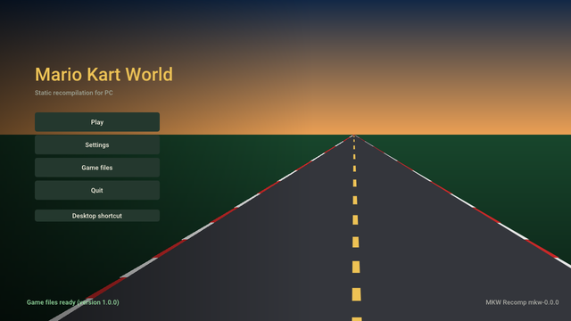

<!-- translated from README.md 94fb2ed2d40b -->

<p align="center"></p>

<h1 align="center">mkw-recomp</h1>

<p align="center">
  <b>Mario Kart World (Nintendo Switch 2) recompilado para rodar nativamente no Linux e no Windows.</b>
</p>

<p align="center">
  <a href="https://github.com/adriadam10/mkw-recomp/releases/latest"></a>
  <a href="https://github.com/adriadam10/mkw-recomp/releases/latest"></a>
  <a href="https://github.com/adriadam10/mkw-recomp/releases/latest"></a>
</p>

<p align="center">
  <b><a href="https://github.com/adriadam10/mkw-recomp/releases">Versões</a></b> ·
  <a href="../../CHANGELOG.md">Mudanças</a> ·
  <a href="../../CONTRIBUTING.md">Contribuir</a> ·
  <a href="../../docs/research.md#sources">Fontes</a> ·
  <a href="../../docs/roadmap.md">Roteiro</a> ·
  <a href="../../docs/performance.md">Desempenho</a> ·
  <a href="https://github.com/adriadam10/mkw-recomp/issues">Issues</a> ·
  <a href="https://github.com/adriadam10/mkw-recomp/discussions">Discussões</a> ·
  <a href="https://archive.org/search?query=subject%3A%22mkw-recomp%22">Arquivo</a>
</p>

<!-- i18n-bar:start -->
<p align="center">
  <a href="../../README.md">English</a> ·
  <a href="README.zh-CN.md">简体中文</a> ·
  <a href="README.es.md">Español</a> ·
  <a href="README.ar.md">العربية</a> ·
  <a href="README.hi.md">हिन्दी</a> ·
  <b>Português (Brasil)</b> ·
  <a href="README.pt-PT.md">Português (Portugal)</a>
</p>
<!-- i18n-bar:end -->

Uma recompilação estática de *Mario Kart World* (Nintendo Switch 2, versões 1.0.0 e 1.8.0) em um programa nativo de
PC para Linux e Windows. Ele precisa da sua própria cópia do jogo, extraída do seu próprio console: nada do jogo está
neste repositório nem nas suas versões publicadas.

**É uma recompilação, não um emulador.** O código AArch64 do jogo é traduzido para C com antecedência e compilado
para a CPU do PC (x86-64, ou AArch64 no Linux); não há interpretador nem JIT de CPU. A GPU também não é emulada: o
NVN2, a API gráfica do Switch 2, é reimplementado sobre Vulkan no nível da API, e os shaders SM86 do jogo são
traduzidos para SPIR-V com antecedência. As funções do SDK da Nintendo (`nn::*`) são substituídas pelo nome por código
próprio.

## Status

No começo, e avançando rápido. Em 12/11/2026:

- Ele inicia, reproduz os vídeos de abertura, passa pelos menus e roda corridas, no Linux e no Windows (x86-64), e no
  Linux em AArch64 (com seu próprio AppImage; testado em um portátil com Adreno 740).
- A tela inicial prepara o jogo a partir da sua cópia na sua máquina (gera e compila o C, traduz os shaders, aquece o
  cache de pipelines) e guarda todas as configurações: tela, qualidade gráfica, controles, hacks.
- As corridas rodam a 60 fps em GPUs de ponta e a 30 nas intermediárias; veja [Desempenho](#performance).
- Problemas conhecidos: alguns menus (modo, seleção de personagem e de veículo) ainda precisam de trabalho, a sombra do
  kart perde um quadro de vez em quando, parte do áudio corta nos vídeos e com alguns drivers da AMD a GPU pode
  travar. Não há jogo online.

## Roteiro

O principal trabalho em aberto, em ordem; os detalhes estão em [docs/roadmap.md](../../docs/roadmap.md).

- **60 fps nas corridas.** Hoje um quadro de corrida é uma cadeia em série: o jogo termina seu quadro (~3 ms\*), depois
  o back end Vulkan grava o grande envio do jogo (~19 ms\*), depois a GPU o executa (~10 ms\*), e só então começa o
  próximo quadro.
  Gravar está no caminho crítico, então o trabalho é gravar usando menos CPU: estado dinâmico só quando muda, caches de
  desenhos entre quadros, gravação em paralelo e uma thread do jogo mais rápida.
- **A imagem como no console**: os últimos bugs do tradutor de shaders, a sombra do kart, push constants, zero erros
  de validação do Vulkan.
- **Todos os menus conferidos** com o console: os próximos são modo e seleção de personagem e de veículo.
- **Sem travamentos de GPU** e menos memória de GPU; depois, carregamentos sem engasgos e um pacote para distribuições
  Linux que não são rolling release.
- **A 1.8.0 no mesmo nível da 1.0.0**: seu aspecto ultrawide, o tamanho do mapa de sombras e a semente fixa
  ([#19](https://github.com/adriadam10/mkw-recomp/issues/19)).

\* Medido em 09/11/2026 na nossa máquina de teste: APU Radeon 660M (Ryzen 5 7535HS), Linux, resolução interna 720p.

<a id="performance"></a>

## Desempenho

Os tempos de quadro medidos, cada um com sua data, estão em [docs/performance.md](../../docs/performance.md). Para incluir a
sua máquina, abra um
[relatório de desempenho](https://github.com/adriadam10/mkw-recomp/issues/new?template=performance.yml): ele entra na
tabela com a data do relatório. Os tempos são os quadros do próprio jogo: a geração de quadros mostra mais quadros, mas
não os encurta. 16,7 ms são 60 fps; com Taxa de quadros em Automático (a do console) cai para 30 fps quando 60 não são
alcançados, e um quadro acima de 33,3 ms faz a corrida rodar mais devagar que o tempo real.

| Data | GPU | Resolução interna | fps na corrida | Tempo de quadro |
|---|---|---|---|---|
| 11/11/2026 | RX 7900 XTX (Windows) | 2160p | 60 | 16,7 ms |
| 11/11/2026 | RX 9070 XT (Linux, RADV) | 720p a 2160p | 60 | 16,7 ms |
| 10/11/2026 | RTX 3060 (Windows) | 1080p | ~48 | ~21 ms |
| 11/11/2026 | RTX 3050 Laptop (Windows) | 720p | ~37 | 26,7 ms |
| 09/11/2026 | Radeon 660M (Linux, RADV) | 720p | 30-32 | 31-33 ms |
| 11/11/2026 | GTX 1650 SUPER (Windows) | 1080p | ~24 | ~41 ms |
| 09/11/2026 | GTX 1050 Ti (Windows) | 1080p | 22-24 | 42-45 ms |

## Como jogar




1. Extraia o dump de Mario Kart World 1.0.0 ou 1.8.0 do seu Switch 2 (`exefs/` e `romfs/`, descriptografados; a 1.8.0
   com a atualização mesclada à RomFS do jogo base), ou esse mesmo dump empacotado em um único arquivo `.nup` ou `.nx`.
2. Baixe o launcher para o seu sistema em [Versões](https://github.com/adriadam10/mkw-recomp/releases): no Linux o
   `.AppImage` (`-aarch64` em ARM; ele guarda o jogo que prepara em `~/.local/share/mkw-recomp`; glibc 2.31 ou mais
   recente: Debian 11, Ubuntu 20.04, SteamOS e posteriores), no Windows o `.zip`, descompactado em uma pasta. Os dois
   precisam de uns 30 GB livres.
3. Execute o AppImage (antes, `chmod +x`) ou o `mkw.exe`, abra **Arquivos do jogo**, aponte para o seu dump (**Escolher
   pasta** ou **Escolher arquivo .nup ou .nx**) e clique em **Preparar**.
   A primeira preparação demora um pouco (compila o jogo inteiro e baixa o `nvdisasm` e o `ptxas` da NVIDIA, 84 MB no
   Linux e 126 MB no Windows, para descrever a codificação dos shaders na sua máquina); depois, **Jogar**.
4. Quando sai uma versão nova, a tela inicial a oferece (**Atualizar para vX**): ela baixa, verifica, substitui o
   programa e prepara de novo só o que mudou. **Configurações → Menu → Buscar atualizações** desativa essa verificação.

Requisitos: CPU x86-64 com AVX2 (ou, no Linux, AArch64 com ARMv8.2: LSE, FP16, RCpc, DotProd, CRC32), uma GPU com
Vulkan 1.3 (`VK_EXT_mesh_shader` recomendado; sem ele, os task e mesh shaders rodam como compute) e 16 GB de RAM
recomendados. Em um contêiner Docker ou Podman no Linux, permita `userfaultfd` no perfil seccomp (o padrão do Docker o
recusa): sem ele, o port não sabe qual memória do jogo mudou e roda várias vezes mais devagar.

## Recursos extras

Além do console, todos opcionais e desligados (ou no valor do console) por padrão:

- **Tela**: resolução interna acima ou abaixo da do console, 21:9, 32:9 e 48:9 (as corridas mostram mais nas laterais),
  escala AMD FSR 1, HDR em telas HDR, VSync, apresentação mailbox ou imediata.
- **Geração de quadros**: quadros criados entre os do jogo (uma corrida a 30 fps mostrada a 60, ou a 240 em uma tela
  de 240 Hz). Mais fluido, não mais rápido: a imagem chega até um quadro depois, e movimentos rápidos e o minimapa
  podem borrar.
- **Gráficos**: filtragem e qualidade de texturas, distância de detalhes e qualidade de sombras acima ou abaixo das do
  console.
- **Som**: som surround 5.1.
- **Controles**: todas as teclas e botões remapeáveis, câmera com o mouse, ícones de botões da Nintendo, Xbox ou
  PlayStation, direção por movimento, intensidade da vibração; multijogador local com um controle para cada um.
- **Hacks**: turbo (segurar ou alternar F2), pular vídeos, desbloquear tudo, a mesma aleatoriedade sempre, direto para
  contra o relógio ou modo livre.
- **Idiomas**: os menus em 20 idiomas; o próprio jogo também em catalão, galego e basco.
- **Arquivos do jogo**: um dump em pastas ou em um único arquivo `.nup` ou `.nx`, usado onde está; atualizações pela
  tela inicial.
- **Sobreposição de desempenho** (FPS, ou CPU, GPU e memória por completo) e informações do sistema em um clique para
  relatórios de bugs.

## Mods

A página **Mods** da tela inicial instala os mods do jeito que são publicados para o jogo e os lista em duas abas:

- **Buscar no GameBanana**: os mods de Mario Kart World no [GameBanana](https://gamebanana.com/games/22152), listados
  ou pesquisados, com o autor, a licença, as capturas de tela e a descrição de cada um. **Instalar** baixa o arquivo do
  GameBanana, só quando você pede.
- **Instalados**: os seus mods, cada um com seu interruptor; **Importar zip / Importar pasta** recebe um mod que você
  já tenha (`.zip`, `.rar` ou `.7z`, com `romfs/` e/ou `exefs/` em qualquer lugar, inclusive na estrutura
  `atmosphere/contents/`).

Os mods que substituem arquivos do jogo (`romfs/`: skins, texturas, textos, pistas) valem a partir da próxima
inicialização. Os que mudam o código do jogo (patches `.ips` ou `.pchtxt` de `exefs/`, como 200cc ou 30 FPS) são
incorporados ao código do jogo: ligar ou desligar um o recompila antes de jogar (alguns minutos). Dois mods que mudam o
mesmo pacote são mesclados arquivo por arquivo, e a página pergunta qual vale onde os dois mudam o mesmo arquivo. A
página avisa sobre mods que substituem as configurações gráficas ou os shaders do jogo, que o port trata do seu jeito.

Os mods são feitos por outras pessoas e não são testados por este projeto: um mod pode travar o jogo ou danificar o
seu save. Leia a página de um mod antes de instalar, guarde uma cópia do seu save e informe os problemas de um mod ao
autor dele; quando relatar um bug aqui, diga quais mods estavam ligados (o log os lista), ou tente antes sem eles.

## Compilar a partir do código-fonte

Linux, com `uv`, `clang`, `lld`, `ninja`, SDL3, Opus, libvpx, zstd, xxHash, os cabeçalhos do Vulkan e VMA 3.4.0
(detalhes em [tools/build/README.md](../../tools/build/README.md)). Coloque o seu dump em `game/` (`game/exefs`,
`game/romfs`) ou defina `MKW_GAME=<dir>`, e na raiz do repositório:

```sh
uv run python recomp/gen.py --exefs game/exefs --out build/generated --jobs 8 --patches recomp/patches-mkw.txt  # 1.8.0: patches-mkw-180.txt
uv run tools/shaders/extract.py && uv run tools/shaders/translate.py
uv run tools/build/build.py              # build/mkw; --target windows compila o mkw.exe com llvm-mingw
build/mkw
```

A partir de um dump empacotado (`.nup`, `.nx`) e para Linux em AArch64:
[tools/build/README.md](../../tools/build/README.md#a-packed-dump) e [sua seção AArch64](../../tools/build/README.md#linux-aarch64).

Traduzir os shaders precisa da especificação da codificação SM86, gerada a partir do `nvdisasm` da NVIDIA (não
distribuído): veja [tools/shaders/README.md](../../tools/shaders/README.md). Tudo o que é gerado vai para `build/`, nunca
para o git.

| Pasta | Conteúdo |
|---|---|
| [recomp/](../../recomp/README.md) | O gerador: AArch64 → C |
| [runtime/](../../runtime/README.md) | O que faz o papel do console: kernel, memória, substitutos do SDK, NVN2 sobre Vulkan, áudio, entrada, menus e launcher |
| [sm86/](../../sm86/README.md) | O tradutor de shaders: SASS SM86 → GLSL → SPIR-V |
| [i18n/](../../i18n/README.md) | Os textos dos menus, da tela inicial e da preparação em todos os idiomas (gettext `.po`) |
| [tools/](../../tools/README.md) | Análise, preparação, compilação, partidas e diagnósticos |
| [tests/](../../tests/README.md) | Testes sem o jogo nem GPU, no CI em Linux e Windows |
| [docs/](../../docs/README.md) | Pesquisa, fontes e desempenho |
| `.github/` | CI, modelos de issues e de pull requests |

Na raiz: `pyproject.toml` e `uv.lock` (o ambiente Python das ferramentas), `.gitignore`, `LICENSE`, `CONTRIBUTING.md`,
`CHANGELOG.md` (as mudanças de cada versão, suas notas) e `AGENTS.md` (um guia para agentes de programação).

## Decisões de projeto (30/10/2026)

| Tema | Decisão | Por quê |
|---|---|---|
| CPU | Tradutor AArch64→C baseado no do [totk-pc-recomp](https://github.com/valentderah/totk-pc-recomp) (MIT), estendido a ARMv8.1-8.3: atômicos LSE, CAS, LDAPR; PAC como identidade, tags MTE como 0 | A mesma família de engine do MKW, e já escala para um executável grande |
| Sistema | As funções `nn::*` do SDK substituídas pelo nome; assinaturas tiradas dos nomes decorados dos 1 289 imports do `main` | Não há serviços do console a emular |
| Gráficos | NVN2 sobre Vulkan: 529 das suas 699 funções têm o mesmo nome que no NVN1 (assinaturas conhecidas pelo totk-pc-recomp e pelo nxnative); 170 são novas | Recompilação, não emulação da GPU |
| Shaders | Tradutor próprio SM86→SPIR-V, offline, com um decodificador gerado a partir da especificação do DocumentSASS / nvsass-disassembler | Cobre mesh/task e o que falta no Maxwell |
| Recursos opcionais do Switch 2 | HDR ligado sozinho quando a tela está em HDR, como no console (Configurações > Tela > HDR: Automático ou Desligado); DLSS, ray tracing e toque atrás de opções, desligados por padrão; desligados, as funções do NVN2 existem, mas não fazem nada, para o jogo seguir o caminho normal | Extras do hardware do console, não são necessários para jogar |
| Padrões | A aparência e a resolução do console; configurações mais baixas são opções | O jogador escolhe |

## Como foi feito

Este port foi escrito com o [Claude](https://claude.com/claude-code) (o agente de programação da Anthropic) fazendo a
maior parte da digitação, sob a minha direção, em cerca de dez dias de trabalho em tempo integral: 489 commits desde
30/10/2026, cada um revisado, medido ou testado antes de entrar. Não foi um prompt e pronto. Por trás disso:

- **Método mais que prompts.** Cada mudança de desempenho foi medida com um A/B dentro da mesma partida (duas
  partidas do mesmo build diferem em até 12 ms por quadro); cada correção de imagem foi conferida com a imagem do
  próprio console; mudanças no tradutor de shaders são testadas fora da GPU em cada um dos 11 561 programas do MKW
  antes de uma partida; capturas de quadros reproduzem o back end em segundos sem o jogo. As regras que saíram dos erros
  estão escritas e são aplicadas por scripts, para o mesmo erro não acontecer duas vezes.
- **O que eu tinha aprendido antes.** O recompilador e o runtime nasceram do
  [totk-pc-recomp](https://github.com/valentderah/totk-pc-recomp) e do seu port para Linux, e do meu trabalho anterior
  em outros recomps (SavageWindRecomp, smo-recomp): o tradutor, o launcher e a preparação que compila o jogo na máquina
  do jogador, os ícones de botões, o fluxo de controle dos shaders. Como mantenedor do
  [AnyPS5](https://github.com/boykopovar/AnyPS5) aprendi a traduzir shaders de GPU com fidelidade, a rodar mesh shaders
  como compute em GPUs que não os têm e a manter um projeto grande honesto com verificações e medições.
- **A pesquisa da comunidade.** As notas do [eden-nx2](https://git.eden-emu.dev/Takoroka/eden-nx2) sobre o Switch 2, a
  codificação SASS da NVIDIA como documentada pelo DocumentSASS e pelo nvsass-disassembler, o Ryujinx e o Mesa NAK
  para a semântica dos shaders, e os outros ports de Switch 2 listados nas fontes.

## Licenças e créditos

Este projeto está sob a [Licença MIT](../../LICENSE). O código tirado de outros projetos mantém a sua própria licença, ao
lado dele (arquivos `LICENSE.*` em [recomp/](../../recomp/), [runtime/](../../runtime/), [sm86/decode/](../../sm86/decode/) e
[runtime/third_party/](../../runtime/third_party/README.md)): totk-pc-recomp, nvsass-disassembler, Dear ImGui, bc7enc,
stb_image, AMD FidelityFX FSR 1 e Roboto. Cada fonte usada, com a sua licença e o que foi tirado dela (código só de
projetos MIT; de projetos GPL, só ideias), está listada em [docs/research.md](../../docs/research.md#sources).

Mario Kart World é © Nintendo. Este projeto não é afiliado nem endossado pela Nintendo, não contém código nem recursos
do jogo e não ajuda a obtê-los.

Os mods pertencem aos seus autores e têm as suas próprias licenças. Este projeto não é afiliado nem endossado pelo
GameBanana nem pelo autor de nenhum mod, não hospeda, revisa nem distribui mods, e não é responsável pelo que um mod
faz: a tela inicial só mostra a listagem pública do GameBanana e baixa um mod do GameBanana quando você pede.

## Contribuir

Veja o [CONTRIBUTING.md](../../CONTRIBUTING.md). Bugs e relatórios de desempenho vão para as
[Issues](https://github.com/adriadam10/mkw-recomp/issues), perguntas para as
[Discussions](https://github.com/adriadam10/mkw-recomp/discussions).
