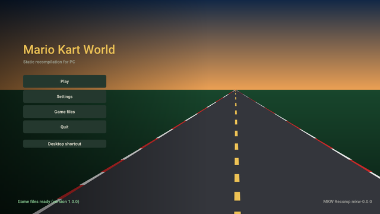

<!-- translated from README.md 64148490d940 -->

<p align="center"></p>

<h1 align="center">mkw-recomp</h1>

<p align="center">
  <b>《马力欧赛车 世界》（Nintendo Switch 2）的重编译版本，可在 Linux 和 Windows 上原生运行。</b>
</p>

<p align="center">
  <a href="https://github.com/adriadam10/mkw-recomp/releases/latest"></a>
  <a href="https://github.com/adriadam10/mkw-recomp/releases/latest"></a>
  <a href="https://github.com/adriadam10/mkw-recomp/releases/latest"></a>
</p>

<p align="center">
  <b><a href="https://github.com/adriadam10/mkw-recomp/releases">发布</a></b> ·
  <a href="../../CHANGELOG.md">更新日志</a> ·
  <a href="../../CONTRIBUTING.md">参与贡献</a> ·
  <a href="../../docs/research.md#sources">来源</a> ·
  <a href="../../docs/roadmap.md">路线图</a> ·
  <a href="../../docs/performance.md">性能</a> ·
  <a href="https://github.com/adriadam10/mkw-recomp/issues">问题</a> ·
  <a href="https://github.com/adriadam10/mkw-recomp/discussions">讨论</a>
</p>

<!-- i18n-bar:start -->
<p align="center">
  <a href="../../README.md">English</a> ·
  <b>简体中文</b> ·
  <a href="README.es.md">Español</a> ·
  <a href="README.ar.md">العربية</a> ·
  <a href="README.hi.md">हिन्दी</a> ·
  <a href="README.pt-BR.md">Português (Brasil)</a> ·
  <a href="README.pt-PT.md">Português (Portugal)</a>
</p>
<!-- i18n-bar:end -->

将《马力欧赛车 世界》（*Mario Kart World*，Nintendo Switch 2，1.0.0 和 1.8.0 版）静态重编译为 Linux 和 Windows 上的原生
PC 程序。你需要自己的游戏副本，并从你自己的主机中导出：本仓库及其发布版本中不包含任何游戏内容。

**这是重编译，不是模拟器。** 游戏的 AArch64 代码会被预先翻译成 C，再针对 PC 的 CPU（x86-64，或 Linux 上的 AArch64）编译；
没有 CPU 解释器，也没有 JIT。GPU 同样不是模拟的：Switch 2 的图形 API NVN2 在 API 层面基于 Vulkan 重新实现，游戏的 SM86
着色器会被预先翻译成 SPIR-V。任天堂 SDK 的函数（`nn::*`）按名称替换为我们自己的代码。

## 状态

尚处早期，但进展很快。截至 2026/11/12：

- 它可以启动、播放开场视频、浏览菜单并进行比赛，支持 Linux 和 Windows（x86-64），以及 AArch64 上的 Linux（有独立的
  AppImage；已在搭载 Adreno 740 的掌机上测试）。
- 启动界面会在你的电脑上用你的副本完成游戏设置（生成并编译 C 代码、翻译着色器、预热管线缓存），并管理所有设置：显示、
  画质、操作、修改项（hacks）。
- 高端 GPU 上比赛可达 60 fps，中端 GPU 上为 30 fps；参见[性能](#performance)。
- 已知问题：部分菜单（模式、角色和车辆选择）仍需完善，赛车的阴影偶尔会丢失一帧，视频中部分音频会中断，在某些 AMD
  驱动上 GPU 可能卡死。没有在线游戏。

## 路线图

主要的待办工作，按优先顺序；详情见 [docs/roadmap.md](../../docs/roadmap.md)。

- **比赛 60 fps。** 目前比赛的每一帧是串行的：游戏完成它的帧（约 3 ms\*），然后 Vulkan 后端录制游戏的大批提交
  （约 19 ms\*），然后 GPU 执行（约 10 ms\*），之后下一帧才开始。
  录制处于关键路径上，因此工作重点是用更少的 CPU 完成录制：只在变化时设置动态状态、跨帧的绘制缓存、并行录制，以及更快的
  游戏线程。
- **与主机一致的画面**：着色器翻译器的最后几个错误、赛车阴影、push constants、Vulkan 验证零错误。
- **所有菜单**都与主机对照检查：接下来是模式、角色和车辆选择。
- **不再出现 GPU 卡死**、更少的显存占用，然后是无卡顿的加载，以及面向非滚动更新发行版的 Linux 包。
- **1.8.0 与 1.0.0 持平**：它的超宽屏比例、阴影贴图尺寸和固定随机种子
  （[#19](https://github.com/adriadam10/mkw-recomp/issues/19)）。

\* 测量于 2026/11/09，我们的测试机：Radeon 660M APU（Ryzen 5 7535HS），Linux，720p 内部分辨率。

<a id="performance"></a>

## 性能

实测的帧时间及其日期见 [docs/performance.md](../../docs/performance.md)。要添加你的机器，请提交一份
[性能报告](https://github.com/adriadam10/mkw-recomp/issues/new?template=performance.yml)：它会以报告日期加入表格。这些时间是
游戏自身的帧：插帧会显示更多帧，但不会缩短它们。16.7 ms 即 60 fps；帧率设为自动（与主机相同）时，达不到 60 会降到
30 fps，而超过 33.3 ms 的帧会让比赛慢于实时。

| 日期 | GPU | 内部分辨率 | 比赛 fps | 比赛帧时间 |
|---|---|---|---|---|
| 2026/11/11 | RX 7900 XTX (Windows) | 2160p | 60 | 16.7 ms |
| 2026/11/11 | RX 9070 XT (Linux, RADV) | 720p 至 2160p | 60 | 16.7 ms |
| 2026/11/10 | RTX 3060 (Windows) | 1080p | ~48 | ~21 ms |
| 2026/11/11 | RTX 3050 Laptop (Windows) | 720p | ~37 | 26.7 ms |
| 2026/11/09 | Radeon 660M (Linux, RADV) | 720p | 30-32 | 31-33 ms |
| 2026/11/11 | GTX 1650 SUPER (Windows) | 1080p | ~24 | ~41 ms |
| 2026/11/09 | GTX 1050 Ti (Windows) | 1080p | 22-24 | 42-45 ms |

## 如何游玩




1. 从你的 Switch 2 导出《马力欧赛车 世界》1.0.0 或 1.8.0（`exefs/` 和 `romfs/`，已解密；1.8.0 需将更新合并进本体的
   RomFS），或将同一导出打包成单个 `.nup` 或 `.nx` 文件。
2. 从[发布](https://github.com/adriadam10/mkw-recomp/releases)下载适合你系统的启动器：Linux 下载 `.AppImage`（ARM 上用
   `-aarch64`；它把设置好的游戏放在 `~/.local/share/mkw-recomp`；需要 glibc 2.31 或更新：Debian 11、Ubuntu 20.04、SteamOS
   及之后的版本），Windows 下载 `.zip` 并解压到一个文件夹。两者都需要约 30 GB 可用空间。
3. 运行 AppImage（先 `chmod +x`）或 `mkw.exe`，打开**游戏文件**，指向你的导出（**选择文件夹**或**选择 .nup 或 .nx
   文件**），然后点击**开始设置**。
   第一次设置需要一些时间（它会编译整个游戏，并下载 NVIDIA 的 `nvdisasm` 和 `ptxas`，Linux 上 84 MB、Windows 上 126 MB，
   用于在你的机器上描述着色器编码）；之后点击**开始游戏**。
4. 有新版本时，启动界面会提示（**更新到 vX**）：它会下载、校验、替换程序，并只重新设置有变化的部分。
   **设置 → 菜单 → 检查更新** 可以关闭此检查。

要求：支持 AVX2 的 x86-64 CPU（或 Linux 上支持 ARMv8.2 的 AArch64：LSE、FP16、RCpc、DotProd、CRC32），支持 Vulkan 1.3 的
GPU（推荐 `VK_EXT_mesh_shader`；没有它时，task 和 mesh 着色器会以 compute 方式运行），建议 16 GB 内存。在 Linux 的 Docker 或
Podman 容器中，需要在其 seccomp 配置中允许 `userfaultfd`（Docker 默认拒绝）：否则移植版无法得知游戏的哪部分内存发生了变化，
运行速度会慢好几倍。

## 额外功能

超出主机的部分，全部可选，默认关闭（或与主机相同）：

- **显示**：高于或低于主机的内部分辨率、21:9 和 32:9（比赛时两侧显示更多）、AMD FSR 1 缩放、HDR 屏幕上的 HDR、垂直同步、
  mailbox 或 immediate 呈现模式。
- **插帧**：在游戏的帧之间生成额外的帧（30 fps 的比赛以 60 显示，或在 240 Hz 屏幕上以 240 显示）。更流畅，但不更快：画面
  最多晚一帧，快速运动和小地图可能出现拖影。
- **画质**：纹理过滤和纹理质量、细节距离和阴影质量，可高于或低于主机。
- **声音**：5.1 环绕声。
- **操作**：所有按键和按钮都可重新绑定，鼠标控制视角，任天堂、Xbox 或 PlayStation 按钮图标，体感转向，振动强度；本地多人
  游戏，每人一个手柄。
- **修改项（hacks）**：加速（按住或切换 F2）、跳过视频、全部解锁、每次相同的随机性、直接进入计时赛或自由漫游。
- **语言**：菜单支持 20 种语言；游戏本身另外支持加泰罗尼亚语、加利西亚语和巴斯克语。
- **游戏文件**：导出可以是文件夹，也可以是单个 `.nup` 或 `.nx` 文件，原地使用；可从启动界面更新。
- **性能叠加层**（FPS，或完整的 CPU、GPU 和内存信息），以及一键获取系统信息用于错误报告。

## 模组

启动界面的**模组**页面会按照模组发布时的样子安装它们，并在两个标签页中列出：

- **在 GameBanana 上查找**：[GameBanana](https://gamebanana.com/games/22152) 上的《马力欧赛车 世界》模组，可浏览或搜索，
  显示每个模组的作者、许可证、截图和说明。**安装**会从 GameBanana 下载文件，仅在你要求时进行。
- **已安装**：你的模组，每个都有开关；**导入 zip / 导入文件夹** 可导入你已有的模组（`.zip`、`.rar` 或 `.7z`，其中任意
  位置包含 `romfs/` 和/或 `exefs/`，也包括 `atmosphere/contents/` 结构）。

替换游戏文件的模组（`romfs/`：皮肤、纹理、文本、赛道）会在下次启动时生效。修改游戏代码的模组（`exefs/` 中的 `.ips` 或
`.pchtxt` 补丁，例如 200cc 或 30 FPS）会被编入游戏代码：开启或关闭其中一个会在游戏前重新编译（需要几分钟）。修改同一个
档案的两个模组会逐个文件合并，若两者修改了同一个文件，页面会询问以哪个为准。页面会对替换游戏画质设置或着色器的模组给出
提醒，因为移植版以自己的方式处理这些内容。

模组由其他人制作，本项目不对其进行测试：一个模组可能导致游戏崩溃或损坏你的存档。安装前请阅读模组页面，备份你的存档，并将
模组的问题反馈给其作者；在这里报告错误时，请说明启用了哪些模组（日志中会列出），或先在不启用它们的情况下再试一次。

## 从源代码构建

Linux，需要 `uv`、`clang`、`lld`、`ninja`、SDL3、Opus、libvpx、zstd、xxHash、Vulkan 头文件和 VMA 3.4.0（详见
[tools/build/README.md](../../tools/build/README.md)）。把你的导出放在 `game/`（`game/exefs`、`game/romfs`），或设置
`MKW_GAME=<dir>`，然后在仓库根目录执行：

```sh
uv run python recomp/gen.py --exefs game/exefs --out build/generated --jobs 8 --patches recomp/patches-mkw.txt  # 1.8.0: patches-mkw-180.txt
uv run tools/shaders/extract.py && uv run tools/shaders/translate.py
uv run tools/build/build.py              # build/mkw; --target windows builds mkw.exe with llvm-mingw
build/mkw
```

从打包的导出（`.nup`、`.nx`）构建以及 AArch64 上的 Linux：[tools/build/README.md](../../tools/build/README.md#a-packed-dump)
和[其 AArch64 部分](../../tools/build/README.md#linux-aarch64)。

翻译着色器需要 SM86 编码规范，它由 NVIDIA 的 `nvdisasm` 生成（不随项目分发）：参见
[tools/shaders/README.md](../../tools/shaders/README.md)。所有生成的内容都放在 `build/`，绝不进入 git。

| 文件夹 | 内容 |
|---|---|
| [recomp/](../../recomp/README.md) | 生成器：AArch64 → C |
| [runtime/](../../runtime/README.md) | 扮演主机的部分：内核、内存、SDK 替代实现、基于 Vulkan 的 NVN2、音频、输入、菜单和启动器 |
| [sm86/](../../sm86/README.md) | 着色器翻译器：SM86 SASS → GLSL → SPIR-V |
| [i18n/](../../i18n/README.md) | 菜单、启动界面和设置程序在各语言下的文本（gettext `.po`） |
| [tools/](../../tools/README.md) | 分析、设置、构建、游戏运行和诊断 |
| [tests/](../../tests/README.md) | 不需要游戏或 GPU 的测试，在 Linux 和 Windows 的 CI 中运行 |
| [docs/](../../docs/README.md) | 研究、来源和性能 |
| `.github/` | CI、issue 和 pull request 模板 |

根目录下：`pyproject.toml` 和 `uv.lock`（工具的 Python 环境）、`.gitignore`、`LICENSE`、`CONTRIBUTING.md`、`CHANGELOG.md`
（每个版本的更改，即其发布说明）和 `AGENTS.md`（给编程智能体的指南）。

## 设计决策（2026/10/30）

| 主题 | 决策 | 原因 |
|---|---|---|
| CPU | 基于 [totk-pc-recomp](https://github.com/valentderah/totk-pc-recomp)（MIT）的 AArch64→C 翻译器，扩展到 ARMv8.1-8.3：LSE 原子操作、CAS、LDAPR；PAC 视为恒等，MTE 标签视为 0 | 与 MKW 同属一个引擎家族，并且已能处理大型可执行文件 |
| 系统 | SDK 的 `nn::*` 函数按名称替换；签名来自 `main` 的 1 289 个导入符号的修饰名 | 无需模拟主机服务 |
| 图形 | 基于 Vulkan 的 NVN2：其 699 个函数中有 529 个与 NVN1 同名（签名已由 totk-pc-recomp 和 nxnative 得知）；170 个是新的 | 重编译，而非 GPU 模拟 |
| 着色器 | 自研的离线 SM86→SPIR-V 翻译器，解码器由 DocumentSASS / nvsass-disassembler 规范生成 | 覆盖 mesh/task 以及 Maxwell 缺少的部分 |
| Switch 2 的可选功能 | 屏幕处于 HDR 时自动开启 HDR，与主机相同（设置 > 画面 > HDR：自动或 OFF）；DLSS、光线追踪和触屏需在选项中开启，默认关闭；关闭时它们的 NVN2 函数存在但不做任何事，游戏走正常路径 | 主机硬件的附加功能，游玩不需要 |
| 默认值 | 与主机相同的外观和分辨率；更低的设置作为选项 | 由玩家选择 |

## 它是如何完成的

这个移植版是在我的指导下，由 [Claude](https://claude.com/claude-code)（Anthropic 的编程智能体）完成大部分编码工作写成的，
用了大约十天的全职工作：自 2026/10/30 起共 489 个提交，每一个都在合入前经过审查、测量或测试。它不是一条提示词就完成的。
背后有：

- **方法重于提示词。** 每项性能改动都在同一次运行中用 A/B 测量（同一构建的两次运行每帧最多相差 12 ms）；每个画面修正都与
  主机自己的画面对照检查；着色器翻译器的改动在运行游戏前，会在 GPU 之外对 MKW 的全部 11 561 个程序进行测试；帧捕获可以
  在几秒内脱离游戏重放后端。从错误中总结出的规则被写下来并由脚本强制执行，同样的错误不会犯第二次。
- **我之前学到的东西。** 重编译器和运行时源自 [totk-pc-recomp](https://github.com/valentderah/totk-pc-recomp) 及其 Linux
  移植，以及我之前在其他重编译项目（SavageWindRecomp、smo-recomp）上的工作：翻译器、启动器和在玩家机器上构建游戏的设置程序、
  按钮图标、着色器的控制流。作为 [AnyPS5](https://github.com/boykopovar/AnyPS5) 的维护者，我学会了如何忠实地翻译 GPU
  着色器、在不支持 mesh 着色器的 GPU 上以 compute 方式运行它们，以及如何用检查和测量让一个大型项目保持可靠。
- **社区的研究。** [eden-nx2](https://git.eden-emu.dev/Takoroka/eden-nx2) 关于 Switch 2 的笔记，DocumentSASS 和
  nvsass-disassembler 记录的 NVIDIA SASS 编码，Ryujinx 和 Mesa NAK 提供的着色器语义，以及来源中列出的其他 Switch 2 移植。

## 许可证与致谢

本项目采用 [MIT 许可证](../../LICENSE)。取自其他项目的代码保留其自身的许可证，放在代码旁边（[recomp/](../../recomp/)、
[runtime/](../../runtime/)、[sm86/decode/](../../sm86/decode/) 和 [runtime/third_party/](../../runtime/third_party/README.md) 中的
`LICENSE.*` 文件）：totk-pc-recomp、nvsass-disassembler、Dear ImGui、bc7enc、stb_image、AMD FidelityFX FSR 1 和 Roboto。
使用过的每个来源及其许可证和所取内容（代码仅取自 MIT 项目；对 GPL 项目只取思路）都列在
[docs/research.md](../../docs/research.md#sources) 中。

《马力欧赛车 世界》© Nintendo。本项目与任天堂无关，也未获其认可，不包含任何游戏代码或资源，也不协助获取它们。

模组归其作者所有，并遵循各自的许可证。本项目与 GameBanana 或任何模组作者无关，也未获其认可，不托管、审查或分发模组，也不对
模组的行为负责：启动界面只显示 GameBanana 的公开列表，并在你要求时从 GameBanana 下载模组。

## 参与贡献

参见 [CONTRIBUTING.md](../../CONTRIBUTING.md)。错误和性能报告请提交到 [Issues](https://github.com/adriadam10/mkw-recomp/issues)，
问题请发到 [Discussions](https://github.com/adriadam10/mkw-recomp/discussions)。
